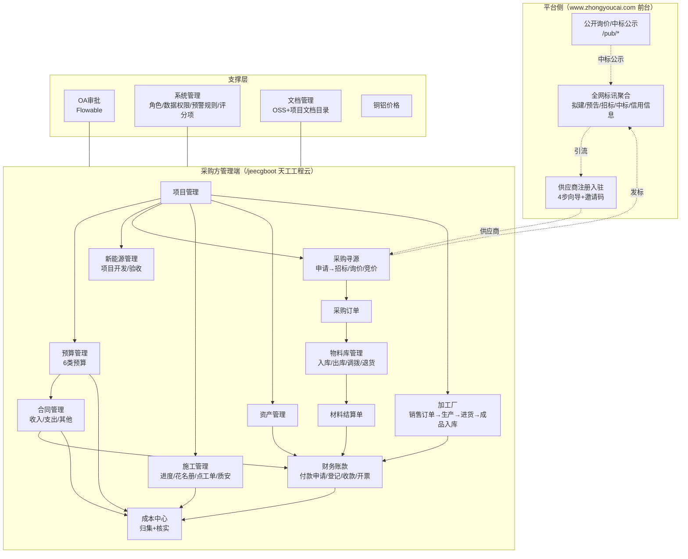
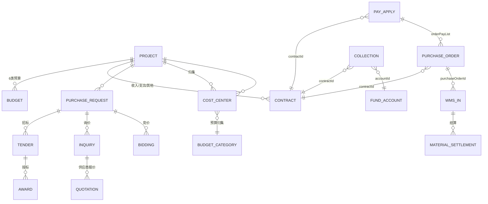

# 竞品逆向 · 中经优采（天工工程云）· 02 业务架构与对象模型

> 证据日期：2026-10-10 ｜ 认识状态：字段名与状态维度为 `E`（接口实测 `P4/F3`）；业务语义映射为 `H`（字段名 + UI 列名 + 文案三方交叉）

---

## 一、总体业务架构

### 三条主干（本产品实际组织方式）

| 主干 | 链路 | 证据 |
|---|---|---|
| **A. 项目经营主链** | 项目 → 预算（6 类） → 合同（收/支/其他） → 产值/签证/执行/结算 → 收付款 → 开票 | 菜单树 + 合同 9 段累计字段 |
| **B. 采购物资主链** | 采购申请 → 招标/询价/竞价 → 采购订单 → 入库单 → 材料结算单 → 付款申请 | 采购管理 25 个二级页面 + 订单 6 段勾稽字段 |
| **C. 成本归集主链** | 各业务单据 → **成本中心**（来源类型 + 预算归集 + 二级预算类型） → 核实 → 实际成本/实付成本 | `/cost/center/list` 63 条真实记录 |

> **架构观察（`H`）**：与 ZW-Insight 的 CBS"账户+流水"模型不同，本产品采用**"单据驱动的成本归集台账"**模型——每一条成本记录绑定一张业务单据（`sourceType` + `sourceId` + `sourceCode` + `sourceTitle`），人工做"预算归集"分类，再经"核实"确认。**没有看到账户余额与流水恒等机制**（见 06 卷）。

---

## 二、对象模型（按域）

> 以下字段名均为接口响应**原始 key**（`E`）。中文语义来自 UI 表头/表单标签（`E`）。

### 2.1 项目（`/project/list`，9 条）

| 字段 | 语义 | 备注 |
|---|---|---|
| `projectId` | 项目 ID | |
| `code` | 项目编号 | |
| `name` | 项目名称 | 实测多为"XX光伏电站项目" |
| `startDate` / `completionDate` | 开工/竣工日期 | |
| `profile` | 项目简介 | |
| `constructionAddress` | 施工地址 | |
| `status` / `statusValue` | **业务状态**（码值 + 中文） | 双字段模式 |
| `rate` | **进度率** | |
| `leaderList` | 项目负责人列表 | 多人 |
| `memberList` | 项目成员列表 | 多人 |
| `categoryId` / `categoryName` | 项目分类 | |
| `archive` | 归档标记 | |
| `frequent` | 常用标记（`frequent=Y` 用于表单快捷选择） | |
| `partIdA` / `partAName` | 甲方（业主） | |

> **状态维度**：项目至少含 `status`（业务）与 `archive`（归档）两个维度。

### 2.2 合同（`/contract/list?label=Income|Expense`，17+25 条）

**主表字段（收/支共用）**

| 字段 | 语义 |
|---|---|
| `contractId` / `code` | 合同 ID / 合同编号 |
| `label` | **`Income` / `Expense`**（收入/支出，同一张表用 label 区分） |
| `type` / `secondType` | 合同类型 / **二级类型**（实测 type 如"对甲合同""采购合同"） |
| `projectId` / `projectName` | 所属项目 |
| `name` / `name2` | 合同名称 / 别名 |
| `partIdA` / `partA` | **合同甲方** |
| `partIdB` / `partB` | **合同乙方** |
| `signDate` / `startDate` / `endDate` | 签订 / 开始 / 结束日期 |
| `receiptTerm` | 收付款条件 |
| `accountName` / `bank` / `bankNum` | **乙方户名 / 开户行 / 银行卡号** |
| `commonType` / `commonTypeValue` | 通用分类 |
| `amount` | **含税金额** |
| `taxRate` / `tax` / `noTaxAmount` | 税率 / 税额 / 不含税金额 |
| `planAmount` | **付款计划总额** |
| `version` / `versionValue` | **合同版本**（修订后 +1，实测 `V1`） |
| `itemList` | 合同明细（名称/含税金额/税率/不含税金额/税额） |
| `contractItemList` | 合同条款明细 |
| `sealFileDetails` | **用印文件** |

**九段累计勾稽字段（本产品最值得研究的模型）**

| 序 | 字段 | 列名 | 语义 |
|---|---|---|---|
| 1 | `amount` | 含税金额 | 合同签署额（基数） |
| 2 | `visaAmount` | 签证金额 | 变更签证累计 |
| 3 | `executionAmount` | 执行金额 | 合同执行（产值/报量）累计 |
| 4 | `settlementAmount` | 结算金额 | 结算单累计 |
| 5 | `invoiceApplyAmount` | 开票申请金额 | 已申请开票累计 |
| 6 | `invoiceAmount` | 发票金额 | 实际收/开票累计 |
| 7 | `payApplyAmount` | 付款申请金额（收入侧列名为"收款登记金额"） | 申请累计 |
| 8 | `recordAmount` | **收/付款登记金额** | 实际登记累计 |
| 9 | — | **`(合同+签证)未收/未付金额`** | = `amount + visaAmount − recordAmount`（**由前两项派生，前端计算列**） |

**成本分解字段（支出侧特有）**：`purchaseOrderAmount`（采购订单）、`materialAmount`（材料）、`pointWorkAmount`（**点工**）、`wagePayAmount`（薪资发放）
> 这 4 个字段说明**支出合同的执行额可按成本来源自动分解**，与本产品"成本中心"归集口径同源。

**状态维度（4 个，必须分开记录）**

| 维度 | 字段 | 实测值 |
|---|---|---|
| 审批状态 | `status` / `statusValue` | `审批中` / `审批通过` |
| 修订状态 | `reviseStatus` / `reviseStatusValue` | `--` / `修订中` |
| 收付状态 | `receiptStatus` | （列表未直出，字段存在） |
| **闭合状态** | `closeStatus` / `closeStatusValue` | `未上传`（= 闭合所需文件未上传） |

> `closeStatus` 的中文值"未上传"说明**合同闭合以"文件上传"为判据**，而非金额条件——这是本产品一个特殊设计（`H`）。

### 2.3 采购申请（`/purchase/request/list`，3 条）

`requestId`、`code`（`CGSQ-2024-00003`）、`title`、`projectId/Name`、`requestUserId/Name`、`requestDate`、`referCode`（关联单号）、`itemList`、`imageList`/`fileList`，以及：

| 字段 | 语义 | 说明 |
|---|---|---|
| `biddingCategory` / `biddingCategoryValue` | **采购方式（大类）** | 与"招标方式"分级 |
| `biddingMethod` / `biddingMethodValue` | **招标方式** | |
| `status` / `statusValue` | 审批状态 | `审批通过` |
| `purchaseStatus` / `purchaseStatusValue` | **采购状态** | 列表实测显示 `--`（未流转） |

> **观察**：采购申请**同时带"采购方式"与"招标方式"两级字段**，说明其设计意图是"申请即可指定走哪条寻源通道（招标/询价/竞价/线下）"（`H`）。

### 2.4 采购订单（`/purchase/order/list`，5 条）

`orderId`、`code`（`PO-2024-00005`）、`title`、`projectId/Name`、`supplierId/supplierName`、`purchaseUserId/Name`、`purchaseDate`、`month`、`requestId/requestName`（关联采购申请）、`contractId/contract`、`itemList`，以及：

| 字段 | 语义 |
|---|---|
| `taxRate` / `quote` / `quoteNoTax` / `tax` | 税率 / 含税报价 / 未税报价 / 税额 |
| `orderAmount` | 订单金额 |
| `autoInOrder` | **自动入库标记** |
| `version` / `versionValue` | **修订版本** |
| `reviseStatus` / `reviseStatusValue` | **修订状态** |
| `analyseQuery` | 分析查询参数（列表页统计用） |

**六段勾稽列（列表页实测表头）**：`含税总额 → 入库金额 → 材料结算金额 → 付款申请金额 → 付款登记金额 → 发票金额`
> 一张订单行上可看到**从下单到开票的六段累计**，是本产品"单据链一眼到底"的核心设计。

### 2.5 入库单 / 材料结算（`/wms/in/list`、`/material/settlement/list`）

**入库单**：`inOrderId`、`code`（`RK-HFSF-2024-00006`）、`purchaseOrderId/purchaseOrderName`（**关联采购订单**）、`inDate`、`supplierId/supplierName`、`itemList`、`materialReceiverId/materialReceiverName`（**收料人**）、`autoOutOrder`（**入库后自动出库**）、`status/statusValue`。

**材料结算单**：`code`、`supplierId/supplierName`、`settlementBy/settlementName`（结算人）、`settlementDate`、`amount`、`itemList`、`status/statusValue`。

> **`autoInOrder` / `autoOutOrder` 一对开关**说明订单→入库、入库→出库**可自动串联**，属工程物料高频场景的效率设计。

### 2.6 项目预算（`/project/budget/list`，3 条）

`budgetId`、`projectId/Name`、`total`（预算总额）、**六类预算字段**、`version/versionValue`、`reviseStatus/reviseStatusValue`、`itemList`、`status/statusValue`。

| 字段 | UI 列名 | 实测样例（永州光伏项目） |
|---|---|---|
| `labor` | 人工总预算 | 1,440,000.00 |
| `material` | 材料总预算 | 3,848,214.00 |
| `device` | 设备总预算 | 0.00 |
| `cost` | 费用总预算 | 150,000.00 |
| `farming` | 分包总预算 | 0.00 |
| `other` | 其他总预算 | 0.00 |
| `total` | 预算总额 | 5,438,214.00 |

> ⚠️ 字段名 `farming`（字面"农"）对应 UI 列"分包总预算"，属**遗留命名**（`H`：疑为早期从农业模板改写的字段名未重命名）。列序与字段序一一对应（人工/材料/设备/费用/分包/其他）。
> **无"设备"与"机械"合并**：本产品把设备单列，而 ZW-Insight 分"机械/劳务/分包/材料/其他"——**预算分类口径不同**，对照时须注意。

### 2.7 成本中心（`/cost/center/list`，63 条）★ 本产品核心

| 字段 | 语义 | 说明 |
|---|---|---|
| `costActual` / `costPaid` | **实际成本 / 实付成本** | 页签"成本中心/实付成本/实际成本"对应 `costPaid=1` 等参数 |
| `sourceType` / `sourceTypeText` | **来源类型** | 实测："薪资发放" |
| `sourceId` / `sourceItemId` / `sourceCode` / `sourceTitle` | 来源单据 ID/明细 ID/单号/标题 | 实测 `XZFF20240125001` / "劳务款" |
| `sourceDate` / `sourceCreatorId` / `sourceCreatorName` | 来源日期 / 来源创建人 | |
| `costDate` | **成本日期** | 与来源日期可不同（权责确认日） |
| `amount` | 金额 | |
| `budgetCategory` / `budgetCategoryText` | **预算归集** | 实测"人工预算" |
| `budgetCategorySub` / `budgetCategorySubCode` | **二级预算类型** | |
| `itemDetail` / `itemType` | 业务明细 / 明细类型 | 实测"工资发放/按人员发放/劳务分包薪资" |
| `verified` / `verifierId` / `verifierName` / `verifyTime` | **是否核实 / 核实人 / 核实时间** | 实测 `已核实`/`未核实` |

**页面操作**：`编辑归集` / `核实` / `取消核实`（三者构成核实状态机）。

> **对照 ZW-Insight**：ZW 的 CBS 是"账户（baseline/actual/commitment/forecast）+ 流水（delta + balance_after）+ 每日归集对账（幂等键）"；本产品是"**单据台账 + 人工归集分类 + 人工核实**"。
> - 本产品**优点**：来源可追溯到具体单据明细（`sourceItemId`），且**有"核实"人工确认环节**（责任到人）；
> - 本产品**弱点**：无余额恒等守卫、无自动归集对账、`budgetCategory` 靠人工选（可能错归集）。

### 2.8 付款申请 / 收款登记（`/pay/apply/list` 15 条、`/collection/list` 27 条）

**付款申请**

| 字段 | 语义 |
|---|---|
| `code` | 单号（`FKSQ20251011001`，无连字符，年月日+3 位） |
| `contractId/contract` | 关联付款合同 |
| `payee` / `payeeName` | 收款方 ID / 名称 |
| `method` | 付款方式（实测"银行转账"） |
| `amount` | 申请金额 |
| `payCategory` / `payCategoryName` | **支出类别**（来自业务字典 `payCategory`，13 项） |
| `applyDate` / `askPayDate` | 申请日期 / 要求付款日期 |
| `accountName` / `bank` / `bankNum` | 收款户名 / 开户行 / 卡号 |
| `paySource` | **付款来源** |
| `invoiceAmount` | 发票金额 |
| `orderPayList` | **采购订单付款明细**（订单金额/已申请/申请中/可申请/本次申请） |
| `inputItemList` | 发票明细（发票号码/开票日期/不含税/总税额/含税总额） |
| **`paidAmount` / `payingAmount`** | **本次申请已付款 / 付款中** |
| `status` / `statusValue` | **审批状态** |
| `payStatus` | **现金状态**（与审批正交） |

> **三段资金占用模型**：申请金额 = 已付款（`paidAmount`）+ 付款中（`payingAmount`）+ 未付。订单级还多一层"**可申请金额**"（= 订单金额 − 已申请 − 申请中）。

**收款登记**：`code`（`SKDJ20260616001`）、`contractId/contract`（收款合同）、`payer/payerName`（付款方）、`amount`、`method`、`revenueCategory/revenueCategoryName`（**收入类别**，来自 `revenueCategory`，3 项）、`collectionDate`、`collectionSource`（**收款来源**）、`accountId` / `funAccount`（**关联资金账户**）、`status/statusValue`。

### 2.9 招标项目（`/epp/rc/list`，7 条）★ 本产品最强环节

| 字段组 | 字段 | 语义 |
|---|---|---|
| 标识 | `rcId`、`bidCode`（`HFSF-2024-00009`）、`floatCode` | 招标 ID / 项目标号 / 浮动码 |
| 关联 | `requestId/requestName`（采购申请）、`projectId/projectName` | |
| 内容 | `title`、`detailList`、`totalBudget` | 标的 / 明细 / 总预算 |
| 组织 | `purchaseDeptId`、`purchaseOrg`、`deptId`、`comId` | 采购组织/部门 |
| 人员 | `writer`、`referrer` | 编制人 / 推荐人 |
| **方式** | `buyWay`（`00`）、`purchaseClass`（`Goods`/`Service`） | 采购方式 / 采购类别 |
| **供应商策略** | `supplierType`（`00`）、`supplierInviteType`（`Public`/定向） | 供应商类型 / **邀请方式** |
| **四关键日期** | `noticePublishDate`（公告发布）、`bidReturnDate`（回标截止）、`bidOpenDate`（开标）、`bidAwardDate`（授标） | 招标时间轴 |
| **多状态维度** | `status`、`serviceStatus/serviceStatusCn`、`bidStatus/bidStatusCn`、`openStatus`、`bidAwardStatus` | 见 03 卷 |
| 变更 | `changeNum`、`changeReason`、`auditDate` | 变更次数 / 原因 / 审核日 |
| 结果 | `bidWinningPrice`、`isSendNotice`、`isPriceAa` | 中标价 / 是否发通知 / 价格 AA |
| 地理 | `titleProvince/City/Area(+Value)` | 标的地区（用于标讯聚合分发） |
| 归档 | `pushId`、`industryDictionaryId`、`serviceStatus` | 推送 ID / 行业字典 |

### 2.10 供应商（`/purchaser/list`，24 条）

| 字段 | 语义 |
|---|---|
| `id` / `supplierId` / `purchaserId` | 主键 / 供应商 / 采购方 |
| `supplierName` / `purchaseName` | 供应商名 / 采购方名 |
| `supplierCreditCode` / `purchaseCreditCode` | **统一社会信用代码（双方）** |
| `supplierLegalName` / `purchaseLegalName` | 法人（双方） |
| `supplierPhone` / `purchasePhone` | 电话（双方） |
| `categoryId` | 供应商分类 |
| `secondaryUserType` / `secondaryUserTypeVal` | **二级分供方类型** |
| `relationType` | **关联交易标记** |
| `status` / `statusValue` | 准入状态（实测"已生效"） |
| `auditRemark` | 审核备注 |
| `inDate` | 入库（准入）时间 |
| `blackCreateTime` / `blackReason` / `blackBy` | **黑名单：时间 / 原因 / 操作人** |
| `contact` / `contactPerson` / `mobilePhone` / `contactPhone` | 联系人/电话 |
| `sunComList` / `sunComDocDetails` | **子公司**列表及材料 |
| `entrustList` / `entrustDocDetails` | **委托**列表及材料 |
| `ref` | 推荐来源 |

**准入分级页签（`E`，列表页）**：`全部 / 准入供方 / 合格 / 试用 / 战略供应商 / 关联交易 / 黑名单`
**页面按钮**：`新增供应商 / 选择供应商 / 邀请供应商 / 导入供应商 / 详情`

> **观察**：供应商档案同时保存**甲乙双方的信用代码与法人**（`supplier*` 与 `purchase*` 成对），说明该系统**在做"采供双方主体核验"**（与 05 卷"信用中国"校验文案呼应）。

### 2.11 预警规则（`/early/warning/list`，4 条）

| 字段 | 语义 |
|---|---|
| `title` | 规则名称（实测：【订单付款申请】超【订单金额】预警；【付款登记】超【付款申请】预警） |
| `warningRule` / `warningRuleParam` | **规则表达式 / 参数** |
| `warningType` / `warningTypeName` | **预警分类**（页签：付款/成本/合同/劳务/进度预警） |
| `warningStatus` | **启用状态**（实测"未启用"） |
| `warningScope` | **预警范围** |
| `receiver` / `receiverList` | 接收人（实测为部门 ID `1637044540814299137`，非个人） |
| `noticeTemplate` | **通知模板** |
| `remark` | 备注 |

### 2.12 角色与数据权限（`/sys/role/list`，12 条）

`roleName`、`roleCode`（实测 `LWY_18205681695`、`ZJL_18205681695`——**缩写_公司ID** 命名法）、`description`、`defaultType`、**`dataScope` / `deptDataScope` / `neDataScope`**（**三级数据权限**）。

**实测角色**：劳务员、总经理、财务经理、行政经理、采购经理、孟总、总裁、项目经理（等 12 个）。
**角色操作**：`用户 / 授权 / 数据权限 / 更多`。

---

## 三、编号规则（`E`，真实单号）

| 对象 | 规则 | 实测样例 |
|---|---|---|
| 采购申请 | `CGSQ-{年}-{5位}` | `CGSQ-2024-00003` |
| 采购订单 | `PO-{年}-{5位}` | `PO-2024-00005` |
| 入库单 | `RK-HFSF-{年}-{5位}` | `RK-HFSF-2024-00006` |
| **招标项目** | `HFSF-{年}-{5位}` | `HFSF-2024-00009` |
| 付款申请 | `FKSQ{年月日}{3位}` | `FKSQ20251011001` |
| 收款登记 | `SKDJ{年月日}{3位}` | `SKDJ20260616001` |
| 薪资发放 | `XZFF{年月日}{3位}` | `XZFF20240125001` |
| 材料结算 | `CLJSD{年月日}{3位}` 或自由文本 | `CLJSD20240418001` |

> **观察**：本产品**编号规则不统一**——采购类用"前缀-年-序号"，财务类用"前缀+年月日+序号"。且实测**允许用户手填/改写单号**（材料结算单出现"2024年 08月26日01"这类自由文本，采购订单出现"yyyy"作为标题）。这是**规范化程度低于 ZW-Insight** 的信号（ZW 有 `serial_number_rule` 统一编号规则表）。

---

## 四、字典与枚举

### 4.1 系统字典（JeecgBoot `sys_dict`，53 个）

其中**业务相关**的仅 14 个：`pruchase_project_status`（采购项目状态，**官方拼写错误，少一个 r**）、`workType`（工种）、`revenueCategory`（收入类别）、`payCategory`（支出类别）、`industry`（行业类别）、`natureOfBusiness`（企业性质）、`accountType`（账户类型）、`sealType`（印章类型）、`warningType`（预警分类）、`commonType`（通用分类）、`resignationReason`（离职原因）、`approvalType`（申请类型）、`bpm_status`（流程状态）、`priority`（优先级）。
其余 39 个为 JeecgBoot 平台字典（`msg_category`/`org_category`/`quartz_status`/`online_*` 等）。

### 4.2 业务字典（`/common/type/list`，**独立表**，16 条，按公司隔离）

> **重要发现**：业务枚举**不在 `sys_dict`**，而在 `/common/type/list`（字段 `dictType` / `name` / `seq` / `enableFlag` / `companyId`）——**按公司（租户）各自维护**，与 JeecgBoot 平台字典分离。

| dictType | 项 |
|---|---|
| `payCategory`（支出类别，13） | 分包费 / 材料费 / 税费 / 差旅费 / 招待费 / 办公用品 / 人工费 / 管理费 / 加油费 / 工作餐 / 往来 / 住宿费 / 现场物资 |
| `revenueCategory`（收入类别，3） | 工程收入 / 项目筹备金 / 银行结息 |

### 4.3 分供方类型（`E`，注册页原文）

`经销商 / 生产厂家 / 劳务分包 / 专业分包 / 班组(个人) / 物资租赁 / 其他`（7 类）

### 4.4 税率枚举（`E`，询价表单原文）

`无税点 / 有税点`，有税点可选：`0% / 1% / 3% / 5% / 6% / 9% / 13%`

---

## 五、对象间关系（`H`，由字段关联 + 页面跳转推断）

**关键外键（实测字段名）**：
- 订单 → 申请：`requestId`；订单 → 合同：`contractId`
- 入库 → 订单：`purchaseOrderId`
- 付款申请 → 合同：`contractId`；付款申请 → 订单（多）：`orderPayList[]`
- 收款 → 合同：`contractId`；收款 → 资金账户：`accountId`
- 成本中心 → 来源单据：`sourceType` + `sourceId` + `sourceItemId`（**多态外键**）
- 合同 → 项目文档目录：`GET /doc/folder/contract-expense?projectId=...`（**合同创建时自动在项目文档下建目录**）

---

## 六、对象模型层面的 Gap（对 ZW-Insight）

| 项 | 中经优采 | ZW-Insight | 判定 |
|---|---|---|---|
| 合同累计链 | **9 段 + 4 状态维度**，且支出侧按成本来源分解 4 字段 | 累计字段较分散 | **借鉴** |
| 采购订单累计链 | **6 段**（下单→入库→结算→申请→登记→发票） | 有累计但未在列表一行并列 | **借鉴** |
| 付款申请资金占用 | **订单级"已申请/申请中/可申请"三段** | `pay_status` 现金口径 + 审批口径 | **借鉴**（互补） |
| 成本归集 | 单据台账 + 人工归集 + 人工核实 | CBS 账户 + 流水 + 自动对账 + 恒等守卫 | **ZW 更强** |
| 编号规则 | 不统一、可手改 | 统一 `serial_number_rule` | **ZW 更强** |
| 供应商档案 | 采供双方信用代码 + 黑名单三字段 + 7 档准入 | 评价 + 黑名单 | **借鉴**（准入分级） |
| 项目分类/进度 | `categoryId` + `rate` + `archive` + `frequent` | WBS 更细 | 各有胜负 |
