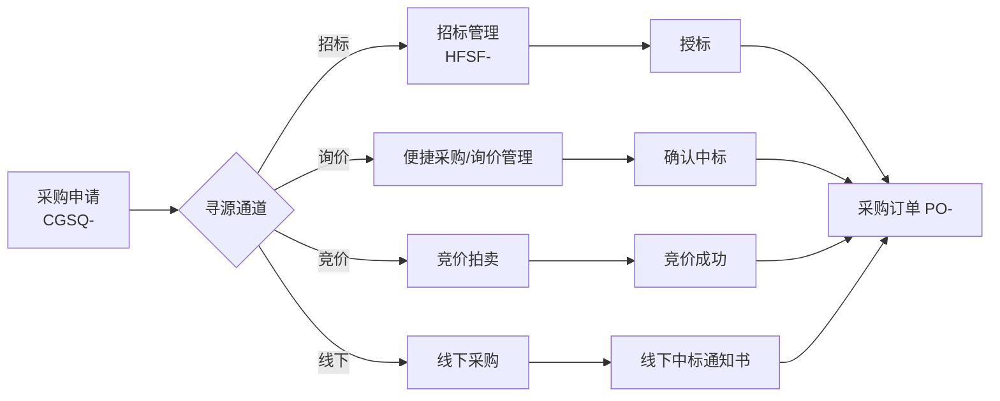
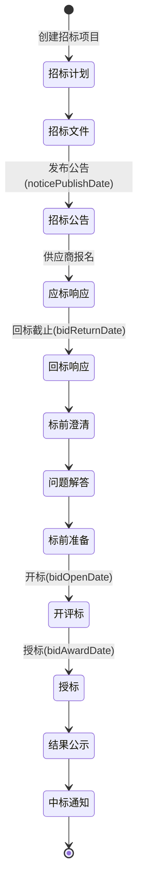
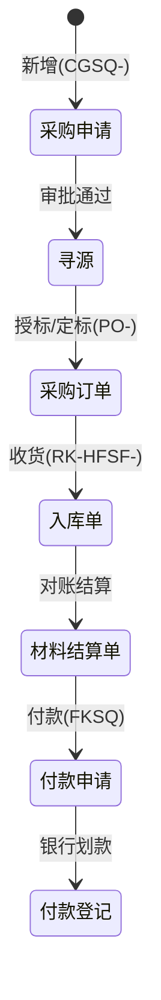
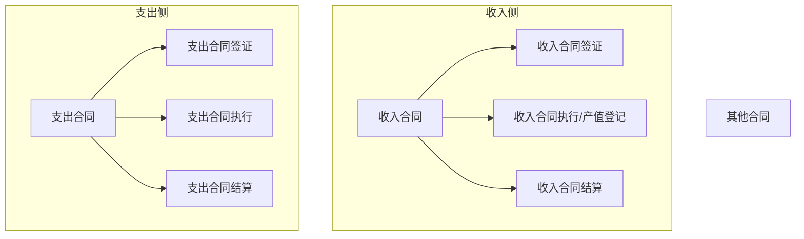
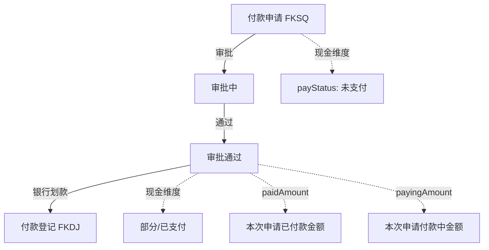
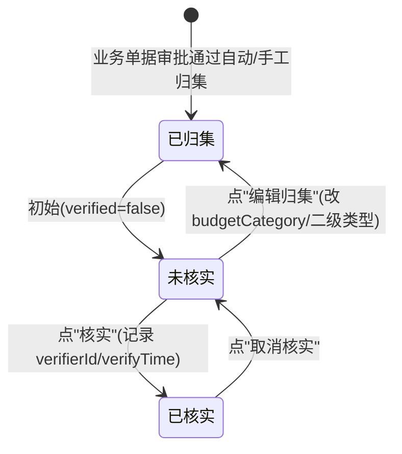

# 竞品逆向 · 中经优采（天工工程云）· 03 业务流转与状态机

> 证据日期：2026-10-10
> **证据强度说明**：本卷状态**值域**（枚举中文）与**节点序列**为 `E`（接口实测 / UI 文案实测）；**迁移的触发动作与前后置校验**因授权为只读、未执行写操作，多为 `H`（由按钮文案 + 必填校验 + 状态值域三向推断），凡 `H` 均标注。

---

## 一、状态维度总表（先拆维度，不合并）

本产品**同一对象普遍带多个正交状态维度**，这是理解其流转的前提（`E`，字段实测）。

| 对象 | 维度 1 | 维度 2 | 维度 3 | 维度 4 |
|---|---|---|---|---|
| 合同 | 审批 `status` | **修订 `reviseStatus`** | 收付 `receiptStatus` | **闭合 `closeStatus`** |
| 采购申请 | 审批 `status` | 采购 `purchaseStatus` | — | — |
| 采购订单 | 审批 `status` | 修订 `reviseStatus` | — | — |
| 付款申请 | 审批 `status` | **现金 `payStatus`** | — | — |
| 收款登记 | 审批 `status` | — | — | — |
| 入库单 | 审批 `status` | — | — | — |
| 预算 | 审批 `status` | 修订 `reviseStatus` | — | — |
| 成本中心 | **核实 `verified`** | 口径（实际/实付，页签参数） | — | — |
| 招标项目 | 审批 `status` | **服务节点 `serviceStatus`** | **投标 `bidStatus`** | **开标 `openStatus`** + **授标 `bidAwardStatus`** |
| 预警规则 | 启用 `warningStatus` | — | — | — |

> **`statusValue` 模式（`E`）**：接口普遍返回 `status`（码）+ `statusValue`（中文）成对字段，说明**中文枚举由后端下发**，前端不含状态映射表（与 00 卷"bundle 无中文状态词"一致）。这使状态值域**完全可枚举**，无需猜测。

---

## 二、采购寻源：一个申请，四条通道

### 2.1 总览



**证据**：菜单树含"招标管理/便捷采购/询价管理/竞价拍卖/线下采购"五条并列二级菜单（`E`）；采购申请带 `biddingCategory`（采购方式）与 `biddingMethod`（招标方式）两级字段（`E`）。

### 2.2 招标：12 节点状态机 ★ 本次逆向最完整的状态机（`E`）

实测接口：`GET /epp/tender/{rcId}/node`，返回**全部 12 个节点**（含未开始的），每节点带 `bidNode` 码、`nodeName`、`status`、`receiveDate`、`completeDate`、`day`（用时）、`img`（图标）、`amount`（数量）。

| 序 | `bidNode` | `nodeName` | 图标 | 实测状态（HFSF-2024-00009） |
|---|---|---|---|---|
| 1 | 20 | **招标计划** | `swhz.png` | `finished` |
| 2 | 21 | **招标文件** | `wjsh.png` | `finished` |
| 3 | 22 | **招标公告** | `gg.png` | `finished` |
| 4 | 23 | **应标响应** | `ybgl.png` | `finished`，`amount=2` |
| 5 | 24 | **回标响应** | `ybgl.png` | `finished`，`amount=2` |
| 6 | 25 | **标前澄清** | `wtcq.png` | `finished` |
| 7 | 26 | **问题解答** | `sr.png` | `finished` |
| 8 | 27 | **标前准备** | `sr.png` | `finished` |
| 9 | 28 | **开评标** | `wtcq.png` | **`processing`** |
| 10 | 29 | **授标** | `sr.png` | `notStart` |
| 11 | 30 | **结果公示** | `fqht.png` | `notStart` |
| 12 | 31 | **中标通知** | `zbtzs.png` | `notStart` |

**节点状态三态（`E`）**：`finished`（已完成，有 `completeDate`）/ `processing`（进行中，有 `receiveDate` 无 `completeDate`）/ `notStart`（未开始，两者皆空且无 `bplId`）。



**服务节点码与中文（`E`，`serviceStatus` / `serviceStatusCn` 实测配对）**：

| `serviceStatus` | `serviceStatusCn` | 对应节点 |
|---|---|---|
| 20 | 招标计划 | 招标计划 |
| 21 | 招标文件 | 招标文件 |
| 27 | 标前准备 | 标前准备 |
| 28 | 开评标 | 开评标 |
| 31 | 中标通知 | 中标通知 |

> 实测 7 条招标记录中：`serviceStatus` 覆盖 `20/21/27/28/31`，证明**该字段与节点表同源**（同一枚举，非独立维度）。
> **`serviceStatus` 是"当前主节点"，不是独立状态维度**——修正 02 卷的分类（`H`，由 7 条数据分布推断）。

**其他状态维度实测值（`E`）**：

| 字段 | 实测值 | 语义（`H`） |
|---|---|---|
| `status` | `0` / `01` | 招标单业务状态（`0`=正常流转，`01`=较早阶段） |
| `bidStatus` / `bidStatusCn` | `1` / `正常` | 招标有效性（正常/流标？） |
| `openStatus` | `01` / `02` | 开标状态（`01`=未开标，`02`=已开标）——与 `bidOpenDate` 是否已过一致 |
| `bidAwardStatus` | `1` / `0` | 授标状态（`1`=未授标，`0`=已授标？）——实测 HFSF-2023-00002（中标通知节点）为 `0` |

> ⚠️ `bidAwardStatus` 的 `1`/`0` 语义**未能确证**（`U`）：7 条中 6 条为 `1`（含未授标的），仅处于"中标通知"节点的那条为 `0`，**与"1=未授标"假设一致但样本仅 1 条**。需在有授标完成的数据上复核。

**招标关键日期四件套（`E`）**：`noticePublishDate`（公告发布）→ `bidReturnDate`（回标截止）→ `bidOpenDate`（开标）→ `bidAwardDate`（授标）。
实测 HFSF-2024-00007 出现 **`bidOpenDate`（2024-12-18）早于 `noticePublishDate`（2024-12-19）** —— 即**开标日早于公告日**，属**时间逻辑倒挂**，说明系统**未做日期先后校验**（`E`，真实数据）。这是一个可借鉴的"该校验而没校验"的反面案例。

**招标方式枚举（`E`）**：`buyWay=00`（列表固定筛选值）；`supplierInviteType` = `Public`（公开报名）/ 定向邀请；`purchaseClass` = `Goods` / `Service`；`supplierType` = `00`。

### 2.3 询价：状态词表（`E` 文案，流转 `H`）

**询价页签四分（`E`）**：`物资询价 / 租赁询价 / 劳务询价 / 班组询价`（对应 API `serviceType=Material|Lease|Labor|Team`）。

**状态词（`E`，来自 UI 文案与分片）**：
`待报名` → `待开标` → `未开始竞价` → `待竞价` → `竞价中` → `待授标` → `结果待发布` → `已发布`
异常：`流标` / `已流标` / `废标` / `询价结束--流标`

**询价单字段（`E`，发布表单实测）**：
- 必填：项目、采购主体公司、**首轮报价截止时间**、**报名费**、**缴纳保证金**、付款方式、收货地
- 选填：采购申请、供应商行业分类、报价须知、附件、联系人、报价要求、税率、价格有效期、交货期
- **报价要求 6 项开关（`E`，原文）**：`含税报价` / `报价需要包含运费` / `允许对询价单部分物料报价` / `落地价` / `要求供应商上传投标文件` / `报价时需录入品牌`
- 明细列：`物料名称 / 规格型号 / 品牌要求 / 物料描述 / 采购量 / 单位`（租赁多一列 `使用天数`）
- 按钮：`发布` / `保存草稿` / `添加明细` / `重置明细` / `下载模板` / `导入明细`

**保证金/报名费证据链（`E`）**：文案 `请上传保证金凭证!`、`请上传报名费凭证!`、`请填写保证金!`、`已缴纳待审核`、`未缴纳` + 独立菜单"保证金管理"。
→ **报名费与保证金是"参与询价的前置缴费闸门"**，且缴费凭证需上传并经审核（`H`）。

**二轮询价（`E`）**：文案 `开启二轮询价` / `已开启二轮询价` / `请选择二轮询价开始时间` / `请选择二轮询价截止时间` + `供应商报价(一轮)` / `供应商报价(二轮)` / `一轮报价开始/结束` / `二轮报价开始/结束` / `最后报价`。
→ **询价支持两轮报价**（`E`）。

**开标密码 / 报价解密（`E`）**：文案 `请填写开标密码!` / `请输入开标密码` / `请填写报价解密时间!` / `报价解密时间`。
→ **报价采用"密封 + 定时解密"机制**（`H`：报价在截止前加密，开标时用开标密码解密），这是**防串标的关键设计**。

**决标方式（`E`）**：文案 `决标方式`、`请填写决标方式!`、`专家决标`、`价格决标`。
→ 两种决标方式：**专家决标**（人工评审）/ **价格决标**（最低价自动）。
> 与"系统管理"下独立菜单 **`技术评分项管理` + `商务评分项管理`** 呼应——专家决标使用可配置的技/商评分项（`H`）。

**代报价（`E`）**：文案 `代报价`。→ 采购方可代供应商录入报价（线下沟通后补录），**这是一个显著的"线下回填"入口**。

### 2.4 竞价：竞价 vs 拍卖（`E` 表单，流转 `H`）

**创建竞价表单四维配置（`E`，原文）**：

| 配置项 | 可选值 |
|---|---|
| **竞价模式** | `竞价` / `拍卖` |
| **邀请方式** | `公开报名` / `定向邀请` |
| **含未税方式** | `含税` / `未税` |
| **公开方式** | `公开竞价排名` / `公开竞价价格` |
| **竞价方式** | `按物料竞价` / `按总价竞价` |

**必填（`E`）**：项目、竞价标题、报名截止时间、竞价开始时间、竞价结束时间、税率、报名费
**选填**：采购申请、邀请方式、含未税方式、公开方式、竞价方式、缴纳保证金、联系人、详细地址

**明细列（`E`）**：`物料名称 / 规格型号 / 品牌要求 / 物料描述 / 采购数量 / 单位 / 起拍价 / 价格梯度`

**竞价规则与约束（`E`，文案原文）**：
- `竞价规则，请务必阅读！` / `竞价协议`（发布前须勾选）
- `竞价金额需大于0`
- `最小报价单位数`（`请输入最小报价单位数`）
- `竞价次数`、`竞价排名`、`公开竞价排名：`、`竞价大厅(按总价报价模式)` / `竞价大厅(按物料报价模式)`
- `确定删除该竞价单吗?`

**竞价状态词（`E`）**：`未开始竞价` / `竞价中` / `竞价已结束` / `竞价成功` / `待授标`

> **判读（`H`）**：这是**真正的反向拍卖引擎**——`起拍价` + `价格梯度`（每次最小降幅）+ `最小报价单位数` + `竞价次数` 构成多轮竞价规则；`按物料竞价/按总价竞价` 是两种大厅模式；`竞价` 与 `拍卖` 是降价/加价两个方向。
> **对 ZW-Insight 的意义**：ZW 的询价仅"一次报价 + 评标排名"，**无多轮竞价、无价格梯度、无密封解密、无两轮报价**——这是本产品**最明确的领先项**（详见 06 卷）。

### 2.5 线下采购（`E`）

菜单"线下采购" + 文案 `上传线下中标通知书` / `选择线下中标供应商`。
→ 线下寻源结果可**回填系统**（上传中标通知书），保持数据完整（`H`）。

---

## 三、采购物资主链：订单 → 入库 → 结算 → 付款



**六段勾稽（`E`，订单列表一行并列）**：
`含税总额` → `入库金额` → `材料结算金额` → `付款申请金额` → `付款登记金额` → `发票金额`

实测样例（`PO-2024-00004`）：含税总额 `8,900.00` → 入库 `1,700.00` → 材料结算 `1,700.00` → 付款申请 `0` → 付款登记 `0` → 发票 `0`。
→ **可读出"部分入库、已结算、未付款"的经营状态**，无需下钻。

**入库单的自动化开关（`E`）**：`autoInOrder`（订单自动生成入库）、`autoOutOrder`（入库自动生成出库）。`materialReceiver`（收料人）独立字段。

**材料结算单**：`settlementBy`（结算人）+ `settlementDate` + `amount` + `itemList`，审批后累计进订单"材料结算金额"（`H`）。

---

## 四、合同全生命周期

### 4.1 四类合同 × 四个动作



**菜单原文（`E`）**：收入合同 / 编辑收入合同 / 产值登记 / 收入合同签证 / 收入合同执行 / 收入合同结算；支出合同 / 支出合同签证 / 支出合同执行 / 支出合同结算；其他合同。

### 4.2 合同累计链（`E`，字段）

```
含税金额 amount
  ├─ +签证金额 visaAmount
  ├─ 执行金额 executionAmount      ← 产值登记/合同执行
  ├─ 结算金额 settlementAmount     ← 合同结算
  ├─ 开票申请金额 invoiceApplyAmount
  ├─ 发票金额 invoiceAmount
  ├─ 付款申请金额 payApplyAmount
  ├─ 收/付款登记金额 recordAmount
  └─ (合同+签证)未收/未付 = amount + visaAmount − recordAmount
```

**支出侧额外按成本来源分解（`E`）**：`purchaseOrderAmount`（采购订单）/ `materialAmount`（材料）/ `pointWorkAmount`（点工）/ `wagePayAmount`（薪资发放）。

### 4.3 合同状态维度与迁移（`E` 值域 / `H` 迁移）

| 维度 | 值域（实测） | 迁移（`H`） |
|---|---|---|
| 审批 `status` | `审批中` / `审批通过` | 提交 → 审批中 → 审批通过 / 驳回（**驳回后状态值未观测，`U`**） |
| 修订 `reviseStatus` | `--` / `修订中` / `V1`(版本) | 点"修订" → 生成新版本 `V(n+1)`，旧版保留 |
| 收付 `receiptStatus` | （字段存在，列表未直出） | `U` |
| 闭合 `closeStatus` | `未上传` | **以文件上传为闭合判据**（`H`） |

**合同表单（`E`，支出合同实测）**：
必填：项目[只读]、合同类型、合同名称、签订日期、合同甲方[只读]、合同乙方[只读]、含税金额、税率
只读（系统带出）：项目、合同甲方、合同乙方、**乙方户名**
选填：合同标签、合同编号、乙方开户行、乙方银行卡号、税额、不含税金额、开始/结束日期、付款计划总额、付款条件、备注、图片、附件
**明细两表（`E`）**：
- 合同明细：`名称* / 含税金额* / 税率* / 不含税金额* / 税额*`
- **付款计划明细**：`计划名称* / 计划日期* / 计划付款金额* / 付款比例(%)* / 付款条件 / 备注`
**审批人**：`指定审批人`（可指定具体人，实测可指定"高岚"）

> **"付款比例(%)" 是关键字段**（`E`，必填）。配合文案 `付款比例总和需为100%` / `收款比例总和需为100%` → **系统校验付款计划比例合计必须等于 100%**。这是本产品在合同侧的一个**硬校验**，比 ZW-Insight 的"资金计划"更贴近合同付款条款本身。

### 4.4 合同创建时自动建项目文档目录（`E`）

实测支出合同表单加载时调用 `GET /doc/folder/contract-expense?projectId=...`，并在项目文档下建目录（本次因权限/项目文档根目录问题报 `项目文档根目录创建失败: {projectId}`）。
→ **合同与文档管理强绑定**：每类单据在项目文档树下有固定目录（`/doc/folder/*` 共 76 个业务目录键，见附录 A）。

---

## 五、资金链：付款 / 收款 / 开票

### 5.1 付款申请：审批与现金双轨



**付款申请三段资金占用（`E`，表单明细列原文）**：
采购订单 | **订单金额** | **已申请金额** | **申请中金额** | **可申请金额** | 本次申请金额
→ `可申请金额 = 订单金额 − 已申请金额 − 申请中金额`（`H`，由列名关系推断）。
→ **"申请中"单列**意味着**审批中的付款申请会占用额度**，防止重复申请超付。这是一个**防超付的关键设计**（ZW-Insight 用 `pay_status` 但未见"申请中"占用）。

**发票明细（`E`）**：发票号码 / 开票日期 / 不含税金额 / 总税额 / 含税总额
**三个发票录入入口（`E`，按钮原文）**：`发票识别`（OCR）/ `手工录入` / `发票夹选择`
**付款申请状态**：审批 `status`（`审批通过`）+ 现金 `payStatus`（与审批正交，`E` 字段存在）

**付款方式（`E`）**：`银行转账` / `现款` / `账期 N 天` / `其他`
**支出类别（`E`）**：来自业务字典 `payCategory` 13 项（差旅费/材料费/分包费/…）
**付款来源（`E`）**：`paySource` 字段

### 5.2 收款登记

`收款登记`（`SKDJ`）→ 关联**收款合同** + **资金账户**（`accountId` / `funAccount`）+ **收入类别**（`revenueCategory`：工程收入/项目筹备金/银行结息）+ **收款来源**（`collectionSource`）+ 收款方式（实测"银行转账"）。

### 5.3 开票与发票管理

- **开票申请**（销项）+ **进项发票** + **销项发票**（财务账款下三菜单）
- **发票管理 → 发票夹**（`/InoviceManage/InvoiceHolder`，注意路径拼写 `Inovice` 为官方拼写错误）
- 合同累计链中 `invoiceApplyAmount`（已申请开票金额）与 `invoiceAmount`（已开票金额）分离
- 文案证据：`已申请开票金额：` / `已开票金额：` / `未开票` / `已开票`
- 文案 `信用中国未查到该企业，请重新输入`（**对接"信用中国"做主体核验**，`E`）
- 文案 `InvoiceCheck` / `InvoiceCheckItem`（分片名）→ **发票查验**功能（`H`）

### 5.4 资金账户管理（独立模块）

`账户管理` / `资金到账` / `资金支付` / `资金调拨` / `余额调整`（各含编辑页）。
→ 与 ZW-Insight 的"银行账户 + 银行流水 + 勾稽"对照：本产品有"资金调拨/余额调整"，**未在接口中观察到银行流水自动导入与勾稽**（`NOT_FOUND`）。

### 5.5 其他支出 / 薪资发放 / 费用管理

- **其他支出**（`/FinancialAccounts/OtherExpense`）：独立支出通道
- **薪资发放**（`XZFF`）：`FinancialAccounts/WagePay`，且**是成本中心的重要来源类型**（实测 63 条成本记录中"薪资发放"占多数）
- **费用管理**：费用报销 / 备用金 / 借款单 / 还款单 / 资金筹备 / 筹备金退回（6 组）
- **多合同付款申请**（`E`，文案）→ 一张付款申请可关联多份合同

---

## 六、成本中心：归集 + 核实（本产品核心机制）

### 6.1 三个页签 = 两种口径（`E`）

| 页签 | 接口参数 | 语义 |
|---|---|---|
| 成本中心 | 无 | 全部归集记录 |
| **实付成本** | `costPaid=1` | **现金口径** |
| **实际成本** | （另一参数） | **权责口径** |

字段 `costActual`（实际成本）与 `costPaid`（实付成本）**同记录并存**（`E`）。

### 6.2 归集与核实状态机



**操作按钮（`E`）**：`编辑归集` / `核实` / `取消核实`
**核实留痕（`E`）**：`verified` / `verifierId` / `verifierName` / `verifyTime`（实测核实人为"安徽快易电"）

### 6.3 归集维度（`E`）

- **来源**：`sourceType`（薪资发放/入库单/…）+ `sourceCode` + `sourceTitle` + `sourceItemId`（**精确到单据明细行**）
- **成本日期**：`costDate`（可 ≠ `sourceDate`，即权责确认日可后移）
- **预算归集**：`budgetCategory`（一级，实测"人工预算"）+ `budgetCategorySub`（二级）
- **业务明细**：`itemDetail` + `itemType`（实测"工资发放/按人员发放/劳务分包薪资"）

**实测样例（`E`）**：
| 来源类型 | 单号 | 预算归集 | 业务明细 | 明细类型 | 金额 | 核实 |
|---|---|---|---|---|---|---|
| 薪资发放 | XZFF20240125001 | 人工预算 | 杨威 | 工资发放/按人员发放/劳务分包薪资 | 5,500.00 | 已核实 |
| 薪资发放 | XZFF20240125011 | 人工预算 | 许龙班组 | /按班组发放/劳务分包薪资 | 5,000.00 | 未核实 |

### 6.4 与 ZW-Insight CBS 的机制对照

| 维度 | 中经优采成本中心 | ZW-Insight CBS |
|---|---|---|
| 记账单位 | **单据归集记录** | 成本账户 + 流水（`delta` + `balance_after`） |
| 分类 | 人工选 `budgetCategory`（一级/二级） | 账户树（WBS/CBS 绑定） |
| 自动性 | 单据驱动生成 + 人工归集 | 每日 `CostRollUpTask` 自动对账（幂等键） |
| 恒等守卫 | **未见** | 有（余额 = SUM(delta)） |
| 人工确认 | **有"核实"环节 + 留痕** | 无对应环节 |
| 双口径 | `costActual` / `costPaid` 同记录 | 审批口径 `total_expense` vs 现金口径 `pay_status` |

> **结论**：两者**口径思路一致（双口径），实现路径不同**。本产品的"**核实**"环节（人工确认成本归集的正确性 + 留痕）是 ZW-Insight **可以借鉴**的（见 06 卷）；而 ZW 的"恒等守卫 + 自动对账"是本产品缺失的。

---

## 七、施工 / 现场 / 人力（简要，`E` 菜单级）

| 链路 | 二级页面 | 证据 |
|---|---|---|
| 进度 | 进度管理（列表/详情/编辑进度/编辑动态）+ 任务管理 | 菜单 |
| 人力 | 花名册（公司级）+ 项目花名册（+人员详情）+ 班组（+详情） | 菜单 |
| **点工** | **点工单**（`ConstructionManagement/DayWork`，含编辑页） | 菜单 + 合同侧 `pointWorkAmount` 字段 |
| 日志 | 施工日志（两套：普通 + `ConstructionLogYS`）+ 日报/周报/月报 | 菜单 |
| 质量 | 质量检查 + **质量整改单**（检查→整改闭环） | 菜单 |
| 安全 | 安全检查 + **安全整改单** | 菜单 |
| 交底 | 交底管理 + 添加交底 | 菜单 |
| 考勤 | 考勤设置 + 考勤列表 | 菜单 |
| 绩效 | 日报/周报/月报（考核版，与施工日报分离） | 菜单 |
| 资产 | 资产列表/入库/领用/退库/借用（+ OA 申请流） | 菜单 |
| 保险 | 保险管理 | 菜单 |
| 专家库 | 专家库（评标专家） | 菜单 |

> **点工单（`E`）**：菜单 + 合同侧 `pointWorkAmount` 累计字段 + 成本中心 `itemType` 含"按人员/按班组发放" → 本产品**有独立的"点工"（日工/零星用工）单据**，且其金额回写合同与成本中心。
> ⚠️ 注意：公开语料中红圈官方功能清单**无"点工单"**；本产品**确有**点工单（`E`，菜单实证）。

---

## 八、审批（Flowable）

**证据（`E`）**：
- `GET /wflow/business/usable/{typeId}`——按**业务类型 ID** 取可用审批流
- `GET /wflow/model/detail/{modelId}`——取流程模型详情
- `GET /wflow/process/task/handler`、`/wflow/process/task/recall/nodes`（**撤回节点**）
- `GET /wflow/process/step/{deptLeader|leader/level|userByRoles|users/belong/depts|depts/belong/depts}`——**审批人选择器**（按部门领导/层级领导/角色/归属部门）
- `/common/approval/cancel`——**审批撤销**

**实测业务类型 ID（`E`）**：`24` = 支出合同、`30` = 材料计划、`51` = 付款申请。
**实测流程模型 ID**：`wf65407546e4b001289f23c4f5`（支出合同）、`wf6548b2f8e4b06d429a1d03f3`（材料计划）。

**表单内审批人配置（`E`）**：`指定审批人`（实测可指定"高岚"）+ `抄送人`（`可添加抄送人`，实测"高岚"）。

**工作台待办（`E`，`/purchasehome`）**：`待我审批`(0) / `我发起的`(4) / `抄送我的`(34) / `我已审批`(30) —— 四类，与 ZW-Insight 的待办模型一致。

**未观测（`U`）**：驳回原因是否必填、撤回是否限发起人、转办/加签/会签是否支持——文案存在 `请输入驳回原因`（`E`），但**未见"防自审"相关文案或字段**（`NOT_FOUND`，详见 06 卷）。

---

## 九、预警机制

**规则表（`E`）**：`warningRule`（规则）+ `warningRuleParam`（参数）+ `warningScope`（范围）+ `receiver`（接收人，实测为部门 ID）+ `noticeTemplate`（通知模板）+ `warningStatus`（启用）。

**预警分类页签（`E`）**：`付款预警 / 成本预警 / 合同预警 / 劳务预警 / 进度预警`（5 类）

**实测 4 条规则（`E`，原文）**：
1. 【订单付款申请】超【订单金额】预警
2. 【付款登记】超【付款申请】预警
3. （另 2 条未在列表页直出名称，接口共 4 条）

**工作台预警卡片（`E`）**：`预警通知` + `未读/已读` 页签 + `查看全部`。

> **对照**：ZW-Insight 有 19 个定时任务 + 7 条风险规则引擎（`RiskScanTask`）+ 预警落站内信；本产品的预警是**规则可配置 + 分类 5 类 + 接收人为部门**，但**未见定时扫描任务证据**（`NOT_FOUND`，后端不可见）。
> 本产品**优势**：预警规则**用户可自行配置表达式与参数**（`warningRule` + `warningRuleParam`），且可**启停**（实测全部"未启用"）。ZW-Insight 的风险规则是**代码硬编码**（`dashboard/risk/rule/*.java`）。→ **可借鉴**。

---

## 十、状态值域汇总（供 04 卷矩阵引用）

| 对象 | 维度 | 值域（`E`） |
|---|---|---|
| 通用审批 | `status` | `审批中` / `审批通过`（`已拒绝`、`已作废`、`已提交，无法编辑` 亦见于文案） |
| 合同 | `reviseStatus` | `--` / `修订中`；`version` = `V1`… |
| 合同 | `closeStatus` | `未上传` / （已上传，`H`） |
| 采购申请 | `purchaseStatus` | `--` |
| 付款申请 | `payStatus` | `未支付` / `已支付` / （部分，`H`） |
| 询价 | 业务 | `待报名` / `待开标` / `未开始竞价` / `待竞价` / `竞价中` / `待授标` / `结果待发布` / `已发布` / `流标` / `已流标` / `废标` |
| 竞价 | 业务 | `未开始竞价` / `竞价中` / `竞价已结束` / `竞价成功` / `待授标` |
| 招标 | `serviceStatusCn` | `招标计划` / `招标文件` / `招标公告` / `应标响应` / `回标响应` / `标前澄清` / `问题解答` / `标前准备` / `开评标` / `授标` / `结果公示` / `中标通知` |
| 招标 | `openStatus` | `01`（未开标）/ `02`（已开标） |
| 招标 | `bidStatusCn` | `正常` |
| 成本中心 | `verified` | `已核实` / `未核实` |
| 预警规则 | `warningStatus` | `未启用` / （已启用，`H`） |
| 供应商 | `status` | `已生效`（准入 7 档见 02 卷） |
| 保证金 | 缴费 | `未缴纳` / `已缴纳待审核` / （已审核，`H`） |

---

## 十一、本卷未决项（`U`）

| # | 未决 | 原因 |
|---|---|---|
| 1 | 各审批流的实际节点序列与办理行为 | 只读授权，未提交单据 |
| 2 | 驳回后是否可改可重提 | 同上（文案有 `请输入驳回原因`，但无迁移证据） |
| 3 | 是否有防自审（发起人不可审自己） | 未在 UI/接口发现，需实测 |
| 4 | `bidAwardStatus` 的 1/0 语义 | 样本仅 1 条为 0 |
| 5 | 询价/竞价的真实数据与完整流转 | 本租户零数据 |
| 6 | 密封报价的加密/解密实现方式 | 仅见"开标密码/解密时间"文案 |
| 7 | 预警规则表达式的语法 | `warningRule` 字段未取到具体值 |
| 8 | 是否存在定时扫描生成预警 | 后端不可见 |
