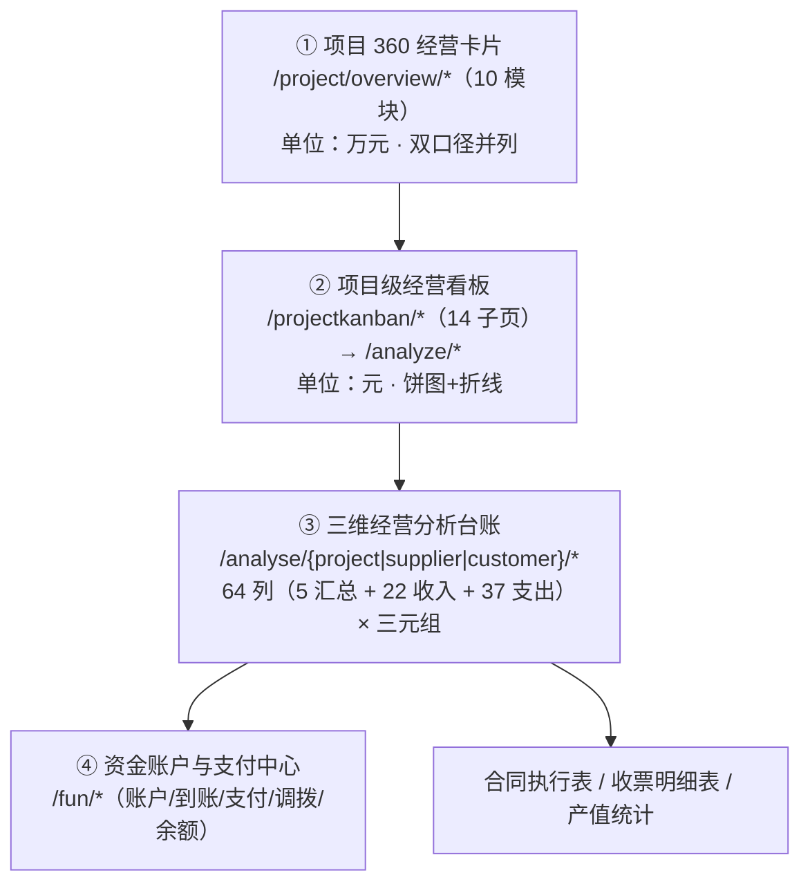
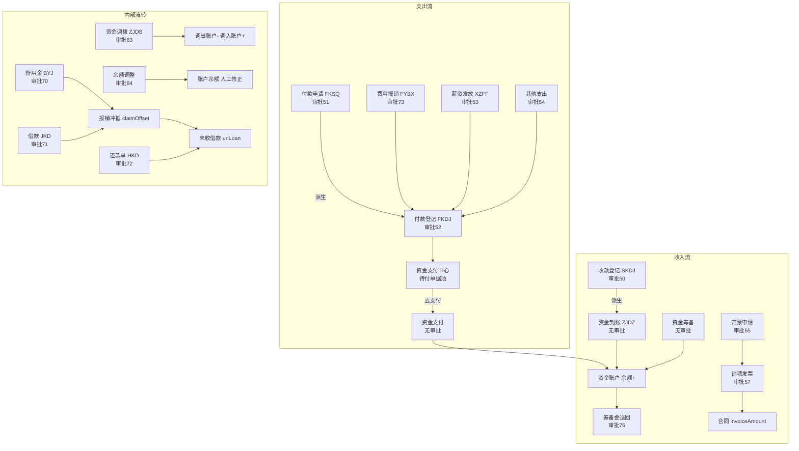

# 竞品逆向 · 中经优采（天工工程云）· 07 资金流转与经营分析

> 证据日期：2026-10-10 ｜ 证据方式：授权只读运行时观察（`E`，`P4/F3`）
> **本卷是全部 8 卷中最重要的一卷**：02 卷只写到**单据字段**、03 卷只写到**单据流转**，而本产品的**资金流转与经营分析**是独立且完整的一层，其深度远超此前的覆盖。
>
> 样本项目：**永州市新田县千乡万村户用分布式光伏电站项目**（`projectId=536cef8d50ed2dd76e1057195cde0f4b`，本租户数据最完整的在建项目）。
> 全公司口径样本：本租户（`companyId=18205681695`，安徽快易电）。

---

## 一、这一层长什么样（总览）



| 层 | 页面/接口 | 粒度 | 单位 | 列/指标规模 |
|---|---|---|---|---|
| ① 项目 360 卡片 | `/project/overview/{10 模块}` | 单项目聚合 | **万元** | 10 卡 × 3 指标 |
| ② 项目级经营看板 | `/projectkanban/{14 子页}` → `/analyze/*` | 单项目分科目 | 元 | 每页 3–6 指标 + 饼图 + 月度折线 |
| ③ 三维经营分析台账 | `/analyse/{project\|supplier\|customer}/list/v1` | 项目/供应商/客户 | 元 | **64 列**（项目维度） |
| ④ 资金账户与支付中心 | `/fun/*` | 账户/流水 | 元 | 5 类台账 |

> **单位不一致（`E`）**：① 层返回**万元**（`totalIncome:"874.08"` = 8,740,800 元），②③④ 层返回**元**。跨层引用必须换算。

---

## 二、① 项目 360 经营卡片（`/project/overview/*`）

### 2.1 卡片清单（`E`，`/project/overview/modules` 原文，按 `sort` 排序）

| sort | code | title | sort | code | title |
|---|---|---|---|---|---|
| 1 | `actual_cost` | 实际成本 | 6 | `safety` | 安全 |
| 2 | `fund` | 资金 | 7 | `invoice` | 发票 |
| 3 | `expense_contract` | 支出合同 | 8 | `paid_cost` | 实付成本 |
| 4 | `expense` | 费用 | 9 | `construction` | 施工 |
| 5 | `income_contract` | 收入合同 | 10 | `quality` | 质量 |

> `/project/overview/modules/config` **仅支持 POST**（GET 返回 `405 不支持GET请求方法，支持以下POST`），用于卡片显隐配置。只读授权未发起 POST，其结构标 `U`。

### 2.2 十张卡片的字段与真实值（`E`）

| 卡片 | 接口 | 字段（原始 key） | 真实值（永州项目，单位万元） |
|---|---|---|---|
| **实际成本** | `actual-cost` | `budgetUsage`、`profitRate`、`totalCost` | `543.82/33.6%`、`38.22/17.3%`、`182.56` |
| **实付成本** | `paid-cost` | `paidBudgetUsage`、`cashProfitRate`、`totalPaidCost` | `543.82/18.4%`、`533.39/84.2%`、`99.80` |
| **资金** | `fund` | `totalIncome`、`totalExpense`、`balance` | `874.08`、`114.57`、`759.51` |
| **收入合同** | `income-contract` | `contractAmount`、`receivedAmount`、`receiveProgress` | `727.65`、`240.89`、`33.1%` |
| **支出合同** | `expense-contract` | `contractAmount`、`paymentAmount`、`paymentProgress` | `428.52`、`72.92`、`17%` |
| **发票** | `invoice` | `inputInvoice`、`outputInvoice`、**`vatPayable`** | `85.11`、`391.40`、`22.32` |
| **费用** | `expense` | `unreturnedLoan`、`pettyCashBalance`、`reimbursement` | `5.15`、`18.01`、`1.11` |
| **采购** | `procurement` | `orderAmount`、`inboundAmount`、`orderPayment` | `14.01`、`14.01`、`0.00` |
| **劳务** | `labor` | `laborContract`、`salaryPaid`、**`dailyWorkAmount`** | `0.00`、`16.85`、`0.53` |
| **施工** | `construction` | `timeProgress`、`constructionProgress`、**`overduePlan`** | `100%`、`0%`、`0个逾期` |
| **质量** | `quality` | `totalInspection`、`totalRectification`、`pendingRectification` | `1`、`3`、`2` |
| **安全** | `safety` | `totalInspection`、`totalRectification`、`pendingRectification` | `0`、`0`、`0` |

### 2.3 双口径是显式并列的（`E`）★

| 口径 | 卡片 | 指标 | 真实值 | 含义 |
|---|---|---|---|---|
| **权责（实际成本）** | 实际成本 | `totalCost` / `profitRate` | 182.56 万 / **17.3%** | 含已发生未付款 |
| **现金（实付成本）** | 实付成本 | `totalPaidCost` / `cashProfitRate` | 99.80 万 / **84.2%** | 只含已付出 |

同一项目**实际利润率 17.3% 与现金利润率 84.2% 相差 66.9 个百分点**（因实付成本 99.80 万 ≪ 权责成本 182.56 万）。**两张卡片并列，系统不合并、不择优**。

> **格式约定（`E`）**：`"金额/百分比"` 字符串。已互验：`budgetUsage:"543.82/33.6%"` 中 543.82 = 项目预算总额（5,438,214 ÷ 10000），33.6% = 182.56 ÷ 543.82（`H`）。
> **`totalCost` 构成（`H`）**：182.56 万 ≈ 材料 172.48 + 人工 0.53 + 其他 8.55 + 费用约 1.0 = 182.56 → **= Σ6 类成本**（与预算 6 分类同源；费用项在 `/analyze/cost/fee/v1` 返回 `null`，按差额反推）。

---

## 三、② 项目级经营看板（`/projectkanban/*`，14 子页）

### 3.1 子页全表（`E`，逐页实测）

| 路由 | 页面标题 | 接口 | 分析维度 |
|---|---|---|---|
| `/projectkanban/byjsy` | **备用金剩余金额** | `/analyze/fund/imprest/v1` | 领取 / 归还 / 冲抵 |
| `/projectkanban/clcb` | **材料成本** | `/analyze/cost/material/v1` | 来源 + **加/减项** + 月度 |
| `/projectkanban/rgcb` | **人工成本** | `/analyze/cost/labor/v1` | 来源 + 月度 |
| `/projectkanban/sbcb` | **设备成本** | `/analyze/cost/device/v1` | 来源方 + 来源 |
| `/projectkanban/fbcb` | **分包成本** | `/analyze/cost/farming/v1` | 来源方 + 来源 |
| `/projectkanban/fycb` | **费用成本** | `/analyze/cost/fee/v1` | 成本明细 + 来源 |
| `/projectkanban/qtcb` | **其他成本** | `/analyze/cost/other/v1` | 来源 + 月度 |
| `/projectkanban/fkdj` | **付款登记** | `/analyze/fund/pay/v1` | 构成 + 按类别 + 按供应商 |
| `/projectkanban/skdj` | **收款登记** | `/analyze/fund/collection/v1` | 构成 + 收入类别 |
| `/projectkanban/qtzc` | **其他支出** | `/analyze/fund/other/v1` | 按类别 + 按收款方 |
| `/projectkanban/fybx` | **费用报销** | `/analyze/fund/expenses/v1` | 月曲线 + 按类别 + 按人员 |
| `/projectkanban/xzff` | **薪资发放** | `/analyze/fund/wage/v1` | 三维构成（见 3.3） |
| `/projectkanban/whsjk` | **未收回借款** | `/analyze/fund/unLoan/v1` | 按借款人 + 按待还 |
| `/projectkanban/xxjd` | **形象进度** | `/analyze/rate/trend/v1` | 进度趋势 |
| `/projectkanban/detail` | 看板详情 | — | 汇总入口 |

> **6 个成本看板与 6 类预算严格一一对应**（材料/人工/设备/分包/费用/其他），与 02 卷 §2.6 的预算 6 字段同源。接口用 `farming` 表示**分包**（同一处遗留命名）。

### 3.2 统一返回结构（`E`）★

**所有指标都是 `{divisor, dividend, rate}` 三元组，所有饼图都是 `{data:[{name, value:{三元组}}]}`**：

```json
// /analyze/fund/collection/v1 真实返回（截取）
{
  "collectionAmount": "6331927.33",
  "contractCollection":  { "divisor": "2408911.00", "dividend": "6331927.33", "rate": "38.04" },
  "unRelatedCollection": { "divisor": "3923016.33", "dividend": "6331927.33", "rate": "61.96" },
  "typePie": { "data": [
    { "name": "工程收入",   "value": { "divisor": "4408911.00", "dividend": "6331927.33", "rate": "69.63" } },
    { "name": "项目筹备金", "value": { "divisor": "1923000.00", "dividend": "6331927.33", "rate": "30.37" } },
    { "name": "银行结息",   "value": { "divisor": "16.33",      "dividend": "6331927.33", "rate": "0.00" } }
  ]}
}
```

> **设计价值（`H`）**：把"分子/分母/占比"随数据一起下发，前端无需自算比例，**从机制上杜绝"各页面分母口径不一致"**。低成本、高一致性，值得借鉴。

### 3.3 关键子页字段与真实值（`E`）

**材料成本**（`/analyze/cost/material/v1`）★ 最完整
- `materialCost` 1,724,789.85 ／ `materialBudget` 3,848,214 ／ `budgetRate` **44.82%** ／ `budgetBalance` 2,123,424.15
- `costAddPie`（**成本加项**）：入库单 140,082（8.12%）、**支出合同执行 1,584,707.85（91.88%）**、调拨单-调入 0
- `costReducePie`（**成本减项**）：退货单 0、调拨单-调出 0
- `monthCostLine`：`{x:[2022-07…2024-04], data:[141379,0,210576,274230,807785,4800,…]}`

**人工成本**：`laborCost` 5,310 ／ `laborBudget` 1,440,000 ／ 0.37%；来源：**点工单 100%**（劳务合同执行 0）

**其他成本**：`otherCost` 85,500 ／ `otherBudget` **0.00** ／ `budgetBalance` **−85,500**
> ⚠️ **超预算时余额为负，未见拦截或告警（`E`）**——与 06 卷"无预算刚性控制"结论一致。

**付款登记**：`payRecordAmount` 734,033.49；`contractPay` 729,233.49（99.35%）、**`unRelatedPay` 无关联付款 4,800（0.65%）**、`orderPay` 0；`typePie` 材料费 100%；`supplierPie` 天津乾益诚钢铁 99.34%

**薪资发放**（三维构成，`E`）：
- 薪资类型：`haveWage` 自有劳务薪资 0 ／ `laborWage` **劳务分包薪资 168,500（100%）**
- 发放方式：`workerPay` 按人发放 5,500（3.26%）／ `groupPay` **按组发放 163,000（96.74%）**
- 发放类型：`wage` 工资 20,500（12.17%）／ `life` 生活费 0

**未收回借款**：`unLoan` 51,500；`repaymentRate` 500/52,000 = 0.96%；`loanPie` 按借款人（其他 96.15% / 高岚 3.85%）；`toRepaymentPie` 按待还（高岚 2.91%）

**备用金剩余**：`imprestAmount` 180,111 ／ `returnAmount` 0 ／ `imprestBalance` 180,111 ／ `claimOffset` **冲抵报销** ／ `otherOffset` **冲抵其他支出**

> ⚠️ **`null` 与 `[]` 的区别（`E`）**：`/analyze/cost/fee/v1`、`/analyze/fund/expenses/v1` 返回 **`null`**（非空结构）；`/analyze/rate/trend/v1` 返回 **`[]`**。前端需兜底，否则易白屏——**接口契约不一致**的小隐患。

---

## 四、③ 三维经营分析台账（`/analyse/*`）★ 经营分析主体

### 4.1 三个维度与列规模（`E`）

| 维度 | 页面 | 接口 | 行数 | 列数 |
|---|---|---|---|---|
| **项目** | 项目经营分析 | `/analyse/project/list/v1` | 9 | **64**（默认选 61） |
| **供应商** | 供应商账款 | `/analyse/supplier/list/v1` | 13 | **25**（纯支出侧） |
| **客户** | 客户账款 | `/analyse/customer/list/v1` | 9 | **16**（纯收入侧） |

另有**合计接口**（不分页）：`/analyse/project/v1`、`/analyse/supplier/v1`、`/analyse/customer/v1`。

**每行是一个"主体"（项目/供应商/客户），每列是一个指标，每个指标都是三元组**：

```json
// /analyse/customer/list/v1 真实行（截取）
{
  "customerName": "黄磊",
  "inAddContract":   { "divisor": "1050000.00", "dividend": "1050000.00", "rate": "100.00" },
  "inContract":      { "divisor": "1000000.00", "dividend": "1050000.00", "rate": "95.24"  },
  "inVisa":          { "divisor": "50000.00",   "dividend": "1050000.00", "rate": "4.76"   },
  "worth":           { "divisor": "810000.00",  "dividend": "1050000.00", "rate": "77.14"  },
  "collection":      { "divisor": "442011.00",  "dividend": "1050000.00", "rate": "42.10"  },
  "unInvoiceOutput": { "divisor": "-442011.00", "dividend": "1050000.00", "rate": "-42.10" }
}
```

### 4.2 项目经营分析的完整 64 列字典（`E`，"字段设置"弹窗原文）★

> **列分组（`E`，弹窗原文）**：`📊 汇总字段 5/5` · `💰 收入分析 19/22` · `💸 支出分析 37/37` · **已选择 61 个字段**。

**📊 汇总字段（5）**

| # | 中文列名 | 对应字段（`H`，由合计接口 key 对齐） |
|---|---|---|
| 1 | 项目余额 | `projectBalance` |
| 2 | 期初金额 | `fundBegin` |
| 3 | 增值税额 | `vat` |
| 4 | 筹备金额 | `found` |
| 5 | 筹备金退回 | `foundReturn` |

**💰 收入分析（22，默认选 19）**

`(合同+签证)金额` · `收入合同` · `收入签证` · `合同收款` · `合同已开票` · `合同未开票` · `产值金额` · `产值未收` · `收入合同结算` · `合同结算未收` · `(合同+签证)未收` · `开票申请` · `销项发票` · `销项税额` · `收款登记` · `发票未收` · **`备用金领取金额`** · **`备用金余额`** · **`未返还保证金`** · `自定义收入总额` · `收入总额` · `还款金额`

**💸 支出分析（37，默认全选）**

`(合同+签证)金额` · `支出合同` · `支出签证` · `合同付款` · `合同已收票` · `合同未收票` · `执行金额` · `执行未付` · `支出合同结算` · `合同结算未付` · `(合同+签证)未付` · `付款申请` · `付款登记` · **`剩余预付款金额`** · `费用报销` · `备用金余额归还` · `薪资发放` · `合同薪资` · `点工金额` · `未回收借款` · `支出总额` · `进项发票` · `进项税额` · `发票未付` · `采购订单` · `(入库-退货)金额` · `入库单` · `退货单` · `材料结算单` · `订单付款` · `订单未付` · `其他支出` · `调拨单-调出` · `调拨单-调入` · `未退回保证金` · `自定义支出总额` · `借款金额`

> ⚠️ **`(合同+签证)金额` 在收入组与支出组同名但不同字段**（`inAddContract` vs `exAddContract`）——做字段映射时不可按中文名去重。
> **`自定义收入总额` / `自定义支出总额`** 两个"自定义"列，说明系统允许用户**自定义扩展指标列**（`H`，配置入口未取证 `U`）。

### 4.3 支出侧字段全集（`E`，`/analyse/supplier/list/v1` 的 25 个 key）

`exAddContract`(合同+签证)金额、`exContract` 支出合同、`exVisa` 支出签证、`exExecution` 执行金额、`exUnExecution` 执行未付、`exSettlement` 支出合同结算、`exUnSettlement` 合同结算未付、`exContractPay` 合同付款、`payApply` 付款申请、`payRecord` 付款登记、`contractWagePay` 合同薪资、`pointWork` 合同点工、`invoiceInput` 发票金额、`unInvoiceInput` 发票未付、`inVat` 进项税额、`procureOrder` 采购订单、`inOrder` 入库单、`inReturnOrder`(入库-退货)金额、`returnOrder` 退货单、`orderPay` 订单付款、`orderUnPay` 订单未付、`materialSettlement` 材料结算单、`exUnAddContract` 未签合同额（实测出现负值 `-168500`）

### 4.4 收入侧字段全集（`E`，`/analyse/customer/list/v1` 的 16 个 key）

`inAddContract`、`inContract`、`inVisa`、`worth` 产值金额、`unWorth` 产值未收、`inSettlement`、`inUnSettlement`、`collection` 收款登记、`inContractCollection` 合同收款、`invoiceOutput` 销项发票、`unInvoiceOutput` 发票未收、`invoiceApply` 开票申请、`exVat` 销项税额

### 4.5 项目维度合计接口真实值（`E`，`/analyse/project/v1`）

`projectBalance` 5,480,213.94 ／ `fundBegin` 0 ／ `vat` 224,006.79 ／ `inContract` 13,086,730 ／ `exContract` 6,307,377.34 ／ `collection` 6,456,960.33 ／ `payApply` 908,057.49 ／ `payRecord` 734,033.49 ／ `exTotal` 1,157,357.39 ／ `inTotal` 6,637,571.33 ／ `impressBalance` 180,111 ／ `unLoan` 51,500 ／ `loan` 52,000 ／ `repayment` 500 ／ `procureOrder` 251,982 ／ `materialSettlement` 5,000

**页面交互（`E`）**：筛选 `日期 / 负责人 / 项目状态 / 项目`（供应商/客户维度再加对应主体）+ 按钮 `查询 / 重置 / 字段设置 / `**`数据解读`**。
> **"数据解读"**：三个分析页均有，说明系统对指标提供文字解释（内容未取证，`U`）。

---

## 五、合同执行表 / 收票明细表 / 产值统计

### 5.1 合同执行表（`/statistic/ContractExecute`）

- 页签 **收入合同 / 支出合同**；接口 `/analyse/contract/execute/list?label=Income|Expense` + **`/total?label=…`**
- 24 列 = 02 卷 §2.2 的 **9 段累计链** + 收/付款登记 + (合同+签证)未收/付金额

**全公司汇总（`E`，`/total` 真实返回）**——这是**合同口径的权威汇总**：

| 指标 | 收入合同 | 支出合同 |
|---|---|---|
| `contractAmount` 合同金额 | 13,086,730.00 | 6,307,377.34 |
| `visaAmount` 签证 | 50,000.00 | 0.00 |
| `executionAmount` 执行 | 3,017,800.00 | 2,084,707.85 |
| `settlementAmount` 结算 | 3,418,019.00 | 921,930.00 |
| `invoiceApplyAmount` 开票申请 | 3,676,519.00 | 0.00 |
| `invoiceAmount` 发票 | 3,924,049.00 | 851,090.00 |
| `payApplyAmount` 付款申请 | 0.00 | 880,723.49 |
| `recordAmount` 收/付款登记 | 2,433,944.00 | 729,233.49 |
| `addContractAmount` (合同+签证) | 13,136,730.00 | 6,307,377.34 |
| **`unRecordAmount` (合同+签证)未收/未付** | **10,702,786.00** | **5,578,143.85** |
| `tax` 税额 | 1,045,285.90 | 693,152.03 |
| `noTaxAmount` 不含税 | 12,041,444.10 | 5,614,225.31 |
| `purchaseOrderAmount` 采购订单 | 0.00 | 8,900.00 |
| `materialAmount` 材料 | 0.00 | 1,700.00 |
| `pointWorkAmount` 点工 | 0.00 | 0.00 |
| `wagePayAmount` 薪资发放 | 0.00 | 168,500.00 |

> **`unRecordAmount` 是全公司"应收 + 应付"的单一事实源**：收入侧 **1,070.28 万未收**、支出侧 **557.81 万未付**。对标 ZW-Insight 的 `biz_receivable` / 应付台账时，这是最该对齐的口径。

**合同枚举码（`E`，`/analyse/contract/execute/list` 真实返回）**：`label`=`Income`/`Expense`；`type`=`ForA`（对甲合同）；`status`=**`PASS`**；`reviseStatus`=**`Finished`**；`closeStatus`=**`NotUploaded`**；`version`=1（数值）。

### 5.2 收票明细表（`/payInvoiceDetailReport`）

- 接口 `/analyse/Invoice/list` + `/analyse/Invoice/selectTotal`；按钮 **`发票核对`**
- 列：序号/项目/**发票来源**/单号/发票号/开票日期/开票方/发票类型/含税金额/税额/不含税金额/**录入方式**
- 字段全集（`selectTotal` 空结构暴露）：`businessId`/`businessCode`/`businessType`/`itemId`/`invoiceNo`/`invoiceDate`/`sellCode`/`invoiceParty`/`invoiceType`/`quote`/`tax`/`quoteNoTax`/`status`/**`upWay`（录入方式）**/`fileUrl`/`folderId`/`docFileId`/`itemList`
- 本租户无数据（`total=0`）

### 5.3 产值统计（`/ProjectOutput/ProjectOutputTotalList`）

- 接口 `/project/output/total/list`
- 14 列：项目/**施工部位**/材料名称/**图纸计量**/**已完成比例**/合同单价/**累计工程量**/**累计发货量**/**累计产值**/**累计材料使用量**/**现场存货**/**累计材料损耗率**/人工合计/备注
- 本租户无数据（`total=0`）

> **这是"工程量—产值—材料消耗"的联动台账**：`图纸计量 → 累计工程量 → 累计产值`，以及 `累计材料使用量 → 现场存货 → 累计材料损耗率`。**材料用量与工程量挂钩**是 ZW-Insight 没有的（ZW 的产值报量与材料消耗是两条独立线）。

---

## 六、资金单据字段级清单（19 张表单，`E`）★ 本节为本卷新增深度

> 标记：`*` 必填；`[只读]` 系统带出不可编辑。审批类型 ID 来自表单加载时调用的 `GET /wflow/business/usable/{typeId}`。

### 6.1 收入侧单据

**① 收款登记** `Receiptregister/postform` ｜ 审批类型 **50**
`项目*[只读]`、`标题*`、`单号`、`收款合同[只读]`、`付款方*[只读]`、`收款账户*[只读]`、`收款金额*`、`收款方式`、`收入类别*`、`收款日期*`、`备注`、`图片`、`附件`
按钮：`上传文件 / 暂存 / 提交`。**无明细表**。
> 收款合同、付款方、收款账户**全部只读** → 说明收款登记**从合同派生**，不允许自由填写。

**② 开票申请** `InvoicingApplication/postform` ｜ 审批类型 **55**
`项目*[只读]`、`标题*`、`单号`、`申请日期*`、`收入合同[只读]`、`收票方*[只读]`、`发票类型*`、**`是否开启容差修改`**、`含税总额*[只读]`、`总税额*[只读]`、`不含税总额*[只读]`、`发票明细*`、`发票抬头`、`税号`、`地址`、`电话`、`开户行`、`银行卡号`、`邮寄信息`、`备注`、`图片`、`附件`
明细：`含税金额(￥) | 税率(%) | 税额(￥) | 不含税金额(￥) | 备注`
按钮：`否 / 删除 / 添加 / 上传文件 / 暂存 / 提交`；审批人 **自选审批人** + 抄送人。
> **`是否开启容差修改`（默认"否"）**——开票金额容差开关。金额字段（含税总额/总税额/不含税总额）**全部只读**，由明细自动汇总。

**③ 销项发票** `OutputInvoice/postform` ｜ 审批类型 **57**
字段与开票申请**完全一致**（含 `是否开启容差修改`、发票抬头/税号/地址/电话/开户行/银行卡号/邮寄信息）。
> **"开票申请"与"销项发票"字段同构**——申请是"要开"，销项是"已开"，同一套字段两个阶段。

**④ 资金筹备** `FinancialPreparation/postform` ｜ **无审批类型**（不走 Flowable）
`项目*[只读]`、`标题*`、`单号`、`收款账户*[只读]`、`收款日期*`、`收款金额*`、`收款方式`、`交易流水号`、`付款方*`、`付款账户`、`付款银行`、`付款账号`、`备注`、`图片`、`附件`
按钮：`上传文件 / 暂存 / 保存`。

**⑤ 筹备金退回** `RefundOfPreparationFunds/postform` ｜ 审批类型 **75**
`项目*[只读]`、`标题*`、`单号`、`付款账户*[只读]`、`付款日期*`、`付款金额*`、`付款方式`、`交易流水号`、`收款方*`、`收款账户`、`收款银行`、`收款账号`、`备注`、`图片`、`附件`
按钮：`上传文件 / 暂存 / 保存`。

### 6.2 支出侧单据

**⑥ 付款申请** `payapply/postform` ｜ 审批类型 **51**
`项目*[只读]`、`标题*`、`单号`、`付款合同[只读]`、`收款方*[只读]`、`付款方式`、`申请金额*`、`采购订单`、`支出类别*`、`申请日期*`、`要求付款日期`、`户名[只读]`、`开户行`、`银行卡号`、`发票金额[只读]`、`发票明细`、`备注`、`图片`、`附件`
明细①（采购订单，**四段占用**）：`采购订单 | 订单金额(￥) | 已申请金额(￥) | 申请中金额(￥) | 可申请金额(￥) | 申请金额(￥)`
明细②（发票）：`发票号码 | 开票日期 | 不含税金额(￥) | 总税额(￥) | 含税总额(￥)`
按钮：`添加 / 发票识别 / 手工录入 / 发票夹选择 / 上传文件 / 暂存 / 提交`

**⑦ 付款登记** `payregister/postform` ｜ 审批类型 **52**
`项目*[只读]`、`标题*`、`单号`、**`付款申请[只读]`**、`付款合同[只读]`、`付款方[只读]`、`收款方*[只读]`、`付款方式`、`付款金额*`、`采购订单`、`支出类别*`、`付款日期*`、`户名[只读]`、`开户行`、`银行卡号`、`发票金额[只读]`、`发票明细`、`备注`、`图片`、`附件`
明细①（采购订单四段）、明细②（发票）——**与付款申请同构**。
按钮：`添加 / 发票识别 / 手工录入 / 发票夹选择 / 上传文件 / 暂存 / 提交`
> **`付款申请[只读]` 字段**证明 **付款登记由付款申请派生**（单据链），但字段集与付款申请几乎相同 → 说明**登记时允许调整实际金额**（支持部分付款）。

**⑧ 薪资发放** `WagePay/postform` ｜ 审批类型 **53**
`项目*[只读]`、`标题*`、`单号`、**`薪资类型*`**、**`发放方式`**、**`发放类型`**、`发放月份*`、`总金额(￥)`、`发放明细*`、`备注`、`图片`、`附件`
明细：`班组 | 应发金额(￥) | 实发金额(￥) | 班组负责人 | 负责人电话 | 开户行 | 银行卡号`
按钮：`添加 / 上传文件 / 暂存 / 提交`
> 三个维度对应看板 `wage` 分析：薪资类型 → `haveWage`/`laborWage`（自有/分包）；发放方式 → `workerPay`/`groupPay`（按人/按班组）；发放类型 → `wage`/`life`（工资/生活费）。

**⑨ 其他支出** `OtherExpense/postform` ｜ 审批类型 **54**
`项目*[只读]`、`标题*`、`单号`、`费用日期*`、`收款方*`、`开户行`、`银行卡号`、`支出总金额(￥)*`、`支出明细*`、`备注`、`图片`、`附件`
明细：`支出金额(￥) | 支出类别 | 费用说明 | 发票金额(￥) | 图片` + `添加发票`
按钮：`上传文件 / 删除 / 添加 / 暂存 / 提交`

**⑩ 进项发票** `InputInvoice/postform` ｜ 审批类型 **56**
`项目*[只读]`、`标题*`、`单号`、`开票日期*`、`支出合同[只读]`、`开票方*[只读]`、`采购订单`、`发票类型*`、`是否开启容差修改`、`含税总额*[只读]`、`总税额*[只读]`、`不含税总额*[只读]`、`发票号码`、`发票代码`、`发票明细*`、`备注`、`图片`、`附件`
明细①（采购订单，**四段占用**）：`采购订单 | 订单金额 | 已开票金额(￥) | 开票中金额(￥) | 可开票金额(￥) | 开票金额(￥)`
明细②（发票）：`含税金额(￥) | 税率(%) | 税额(￥) | 不含税金额(￥) | 备注`
按钮：`发票识别 / 添加 / 否 / 上传文件 / 暂存 / 提交`
> **开票侧也有"已开票/开票中/可开票"四段占用**——与付款侧的"已申请/申请中/可申请"**同构**。这是本产品**统一的"额度占用"范式**。

**⑪ 费用报销** `ExpenseReimbursement/postform` ｜ 审批类型 **73**
`项目*[只读]`、`标题*`、`单号`、`报销日期*`、`报销人*`、`开户行[只读]`、`户名`、`银行卡号`、`报销总金额(￥)*`、`报销明细*[只读]`、**`是否进行冲抵`**、`备注`、`图片`、`附件`
明细：**`*所属项目 | *报销金额(￥) | *支出类别 | 费用说明 | 发票金额(￥) | 图片`** + `添加发票`
按钮：`上传文件 / 删除 / 添加 / 暂存 / 提交`
> **明细含"所属项目"列 → 一张报销单可跨多个项目报账**（`E`）。
> **`是否进行冲抵`开关**对应看板的 `claimOffset`/`otherOffset` 与三向冲抵。

**⑫ 备用金** `Imprest/postform` ｜ 审批类型 **70**
`项目*[只读]`、`标题*`、`单号`、`领取日期*`、`领取人*`、`户名[只读]`、`开户行`、`银行卡号`、`领取金额(￥)`、`备注`、`图片`、`附件`
按钮：`上传文件 / 暂存 / 提交`
> ★ **表单加载时额外调用两个实时查询接口（`E`）**：
> - `GET /feeManage/impress/balance/{projectId}/{userId}` —— 该人该项目的**备用金余额**
> - `GET /feeManage/impress/unReturnOffset/{projectId}/{userId}` —— 该人**未归还的冲抵额**
>
> 即**备用金领取时会实时校验个人余额与在途冲抵**，是防超额领用的机制。

**⑬ 借款单** `LoanBill/postform` ｜ 审批类型 **71**
`项目*[只读]`、`标题*`、`单号`、`借款日期*`、`借款人*`、`开户行[只读]`、`户名`、`银行卡号`、`借款总金额(￥)*`、`借款明细*`、`备注`、`图片`、`附件`
明细：`借款金额(￥) | 借款事由`
按钮：`添加 / 上传文件 / 暂存 / 提交`

**⑭ 还款单** `RepaymentBill/postform` ｜ 审批类型 **72**
`项目*[只读]`、`标题*`、`单号`、`还款日期*`、`收款账户*[只读]`、`还款人*`、`还款总金额(￥)*`、**`普通还款金额(￥)`**、`备注`、`图片`、`附件`
按钮：`上传文件 / 暂存 / 提交`
> 加载时调用 `GET /feeManage/repayment/amount`（查可还金额）。
> **`还款总金额` 与 `普通还款金额` 并列** → 还款区分"普通还款"与（冲抵型）还款（`H`）。

### 6.3 资金账户侧单据（`/fun/*`，均**不走审批流**）

**⑮ 账户管理** `AccountManagement/postform` ｜ 无审批类型
`账户类型*`、`所属公司*[只读]`、`账户名称*`、`开户行*`、`账号*`、`初始余额*`、`初始日期*`、`设为常用`、`备注`、`附件`、**`授权人员*`**、**`授权角色`**
按钮：**仅 `上传文件 / 保存`**（无暂存/提交）
> ★ **两条重要约束（`E`，页面原文）**：
> 1. **「注：该账号一旦被选用，将无法修改」**——账号防篡改。
> 2. **`授权人员` + `授权角色`**——**账户级权限**（哪些人/角色可用此账户），是**资金账户的细粒度授权**。

**⑯ 资金到账** `fundreceipt/postform` ｜ 无审批类型
`标题*`、`单号`、`收款账户*`、`收款日期*`、`收款金额*`、`收款方式`、`交易流水号`、`付款方`、`付款账户`、`付款银行`、`付款账号`、`备注`、`图片`、`附件` → `上传文件 / 保存`

**⑰ 资金支付** `fundpayment/postform` ｜ 无审批类型（标题实测为**"编辑支付流水"**）
`标题*`、`单号`、`付款账户*`、`付款日期*`、`付款金额(¥)*`、`付款方式`、`交易流水号`、`收款方`、`收款账户`、`收款银行`、`收款账号`、`备注`、`图片`、`附件` → `上传文件 / 保存`

**⑱ 资金调拨** `fundallocation/postform` ｜ 审批类型 **83**
`标题*`、`单号`、`调出账户*`、`调入账户*`、`调拨日期*`、`调拨金额(￥)*`、**`调拨事由*`**、`备注`、`图片`、`附件` → `上传文件 / 暂存 / 提交` + 自选审批人 + 抄送人

**⑲ 余额调整** `balanceadjustment/postform` ｜ 审批类型 **84**
`标题*`、`单号`、`调整账户*`、`调整日期*`、**`调整方向*`（调增 / 调减）**、`调整金额(￥)*`、**`调整原因*`**、`备注`、`图片`、`附件` → `上传文件 / 暂存 / 提交` + 自选审批人 + 抄送人

### 6.4 审批业务类型 ID 全表（`E`，实测）★

| ID | 业务 | ID | 业务 | ID | 业务 |
|---|---|---|---|---|---|
| **24** | 支出合同 | **53** | 薪资发放 | **72** | 还款单 |
| **30** | 材料计划 | **54** | 其他支出 | **73** | 费用报销 |
| **50** | 收款登记 | **55** | 开票申请 | **75** | 筹备金退回 |
| **51** | 付款申请 | **56** | 进项发票 | **83** | 资金调拨 |
| **52** | 付款登记 | **57** | 销项发票 | **84** | 余额调整 |
| | | **70** | 备用金 | | |
| | | **71** | 借款单 | | |

**流程模型 ID（`E`）**：24→`wf65407546e4b001289f23c4f5`｜30→`wf6548b2f8e4b06d429a1d03f3`｜52→`wf65407547e4b001289f23c4fb`｜53→`…4fc`｜54→`…4fd`｜55→`…4fe`｜70→`wf65951d0ee4b0e9b5156eac16`｜71→`…17`｜72→`…18`｜73→`…19`｜83→`wf65fd4d27e4b01fdcc25f768a`｜84→`…8b`

**不走审批流的资金单据（`E`）**：**账户管理、资金到账、资金支付、资金筹备**（表单无 `usable/{typeId}` 调用，按钮为"保存"而非"提交"）。
> **这是一个值得注意的设计取舍**：账户开立、资金到账、资金支付、资金筹备**不做审批**，而资金调拨、余额调整**做审批**（且必须填事由/原因）。即**"账户间搬钱要审批，账户进出钱不审批"**（`H`）。

---

## 七、资金流转全景与单据链（本产品实际口径）



### 7.1 单据链（`E`，由只读字段与派生关系实证）

| 上游 | → 下游 | 证据 |
|---|---|---|
| 收入合同 | → 收款登记 | 收款登记的"收款合同/付款方/收款账户"**全部只读** |
| 收款登记 | → 资金到账 | 资金到账列表"来源"列取值 = `收款登记` |
| 采购订单 | → 付款申请 / 付款登记 | 订单**四段占用**明细（已申请/申请中/可申请） |
| 付款申请 | → 付款登记 | 付款登记含只读字段 **`付款申请`** |
| 采购订单 | → 进项发票 | 进项发票的订单**四段占用**（已开票/开票中/可开票） |
| 收入合同 | → 开票申请 / 销项发票 | "收入合同/收票方"只读 |
| 借款 / 备用金 | → 费用报销冲抵 | `是否进行冲抵` 开关 + `claimOffset`/`otherOffset` |
| 各支出单据 | → 资金支付中心 | `/fun/payment/list?payStatus=!PAID` 汇总多单据类型 |
| 各单据 | → 成本中心 | `sourceType`+`sourceId`+`sourceItemId` 多态外键 |

### 7.2 费用报销的"三向冲抵"（`E`）★

费用报销列表汇总行 = `14,523.90 / 0.00 / 0.00 / 14,523.90`，对应列：

`报销总金额 | 冲抵借款金额 | 冲抵备用金金额 | 报销余额`

即 **报销总额 = 冲抵借款 + 冲抵备用金 + 报销余额**。配合备用金看板 `claimOffset`/`otherOffset` 与未收借款看板 `offset`：

```
员工借款 / 备用金 ──→ 发生费用 ──→ 报销单冲抵 ──→ 减少未收借款 / 备用金余额
                                       └→ 差额部分 → 现金报销（进入资金支付中心待付）
```

> **这是一条完整的"个人资金占用 → 费用核销 → 现金补偿"闭环**，三张表（借款/备用金/报销）通过冲抵字段互相勾稽。ZW-Insight 有备用金与报销（`biz_reserve_fund_apply` / `biz_personal_reimbursement`），但**未见显式冲抵字段**。

### 7.3 统一"额度占用"范式（`E`）★

| 场景 | 四段字段 | 证据 |
|---|---|---|
| 付款申请 / 付款登记 | 订单金额 → **已申请 / 申请中 / 可申请** | 明细表头 |
| 进项发票 | 订单金额 → **已开票 / 开票中 / 可开票** | 明细表头 |

> 同一"总量 − 已占用 − 在途 = 可用"模型被复用到**付款**与**开票**两条链。**"在途"单列**（申请中/开票中）是本产品防超付/超开的核心机制。

### 7.4 资金账户模型（`E`）

- **账户类型：公户 / 私户**（私户实测如"永州项目卡"）
- 字段：账户名称、开户行、账号、**账户余额**、**初始余额**、初始日期、**设为常用**、**授权人员/授权角色**
- 余额公式（`H`）：`账户余额 = 初始余额 + Σ到账 + Σ筹备 − Σ支付 − Σ筹备退回 ± Σ调拨 ± 余额调整`
- 账户列表**带汇总行**（实测 `191,152.00 / 80,000.00` = 余额合计 / 初始余额合计）
- **交易流水号**在到账/支付/筹备中均有人工录入字段

> **未发现银行流水自动导入与勾稽**（`NOT_FOUND`）：流水号靠人工录入，无 `/bank/flow/import` 类接口。→ ZW-Insight 的 `biz_bank_flow` + 自动勾稽更强。

---

## 八、口径定义与不一致（`E`）★

### 8.1 本产品的口径事实

| 口径 | 载体 | 说明 |
|---|---|---|
| **权责（实际成本）** | `/overview/actual-cost`、`costActual`、`/analyze/cost/*` | 含已发生未付款 |
| **现金（实付成本）** | `/overview/paid-cost`、`costPaid`、成本中心 `costPaid=1` | 只含已付出 |
| **收付登记口径** | `recordAmount`、`payRecordAmount`、`collectionAmount` | 实际登记额 |
| **在途口径** | `申请中金额` / `开票中金额` | 审批中占用 |
| **应收应付** | `unRecordAmount`、`unWorth`、`unInvoiceOutput` | (合同+签证) − 已登记 |
| **合同累计链** | `visaAmount→executionAmount→settlementAmount→invoiceApplyAmount→invoiceAmount→recordAmount` | 9 段 |

### 8.2 发现的口径问题（`E`，需厂商确认）

| # | 问题 | 证据 |
|---|---|---|
| 1 | **① 层与 ③ 层"收入总额"不一致** | `/overview/fund.totalIncome` = **874.08 万**；`/analyse/project.inTotal` = **663.76 万**（6,637,571.33）。差 210 万，**系统内无口径说明** |
| 2 | **超预算不拦截** | 其他成本 `budgetBalance` = **−85,500**（预算 0） |
| 3 | **同名不同义** | `(合同+签证)金额` 同时出现在收入组（`inAddContract`）与支出组（`exAddContract`） |
| 4 | **接口契约不一致** | 无数据时 `/analyze/cost/fee/v1` 返回 `null`，`/analyze/rate/trend/v1` 返回 `[]` |
| 5 | **字段名遗留** | `farming` 表示"分包"（预算与成本看板均用此名） |

> **对照 ZW-Insight**：ZW 有 `docs/资金流转全景图.md` **显式定义双口径**（审批口径 vs 现金口径）并写明不变量；本产品**双口径实现存在但无文档化口径定义**，导致出现 #1 这类跨层不一致。→ 这是 ZW 的相对优势。

---

## 九、与 ZW-Insight 的逐项对照

| 项 | 中经优采 | ZW-Insight | 判定 |
|---|---|---|---|
| **项目 360 卡片** | 10 卡，**实际成本/实付成本双卡并列** | 有驾驶舱 | 竞品**口径并列更直观** |
| **指标三元组下发** | 全部 `{divisor,dividend,rate}` | 前端计算 | **借鉴（低成本高一致）** |
| **三维分析台账** | 项目/供应商/客户 × **64/25/16 列** | 有供应商/客户账款 | 竞品**指标更密** |
| **自定义指标列** | `自定义收入总额`/`自定义支出总额` | 未见 | 待评估 |
| **无关联收付单列** | `unRelatedPay` / `unRelatedCollection` | 未见 | **借鉴** |
| **额度四段占用（付款/开票）** | 已申请/申请中/可申请；已开票/开票中/可开票 | 付款侧无在途占用 | **借鉴（P0 级）** |
| **报销三向冲抵** | 冲抵借款 + 冲抵备用金 + 报销余额；`是否进行冲抵` | 未见显式勾稽 | **借鉴（P1）** |
| **备用金领取实时校验** | `/impress/balance/{pid}/{uid}` + `/unReturnOffset/...` | 未见 | **借鉴（P1）** |
| **统一资金支付中心** | 跨单据待付池 + 去支付 + 部分支付 | 单据内闭环 | **借鉴（P1）** |
| **资金账户级授权** | `授权人员`/`授权角色` + 账号不可改 | 未见 | **借鉴（内控）** |
| **公户/私户分类** | 显式账户类型 | 未见 | **借鉴（合规）** |
| **账户进出不审批、账户间调拨审批** | 账户/到账/支付/筹备无审批；调拨/余额调整有审批 | — | 设计取舍，可参考 |
| **审批类型 ID 集中注册** | `usable/{24,30,50…84}` 集中管理 | `BusinessType` 注册 | 一致 |
| **工程量-材料-损耗联动** | 产值统计含 `累计材料使用量/现场存货/累计材料损耗率` | 产值与材料分线 | **借鉴（P1）** |
| **预算刚性控制** | **无**（余额可为负） | 有预算控制配置 | **ZW 更强** |
| **银行流水自动勾稽** | 仅流水号人工录入 | 有 `biz_bank_flow` + 勾稽 | **ZW 更强** |
| **逾期未付单列** | 未见 | 有 `overdue_unpaid` | **ZW 更强** |
| **口径文档化** | **无**（跨层不一致） | 有 `docs/资金流转全景图.md` | **ZW 更强** |

---

## 十、本卷未决项（`U`）

| # | 未决 | 原因 |
|---|---|---|
| 1 | ① 层与 ③ 层"收入总额"口径不一致的成因 | 需厂商确认或口径文档 |
| 2 | `/project/overview/modules/config` 卡片配置结构 | 仅支持 POST，只读授权未发起 |
| 3 | "数据解读"按钮的解释内容 | 未点击 |
| 4 | `自定义收入总额/自定义支出总额` 的配置入口与定义方式 | 未取证 |
| 5 | `是否开启容差修改` / `是否进行冲抵` 的实际计算规则 | 需提交单据才能观察 |
| 6 | `还款总金额` 与 `普通还款金额` 的差异规则 | 同上 |
| 7 | 资金支付中心"去支付"的出账行为（是否生成银行流水、是否回写 `payStatus`） | 只读授权未执行 |
| 8 | 账户余额与单据流水是否恒等（有无对账机制） | 后端不可见；仅见"余额调整"人工修正入口 |
| 9 | 形象进度 `/analyze/rate/trend/v1` 的数据来源与字段 | 本租户返回 `[]` |
| 10 | 产值统计的材料损耗率计算口径 | 本租户无数据 |
| 11 | 收入分析组默认未选的 3 列是哪 3 列 | 弹窗仅显示 19/22 |
